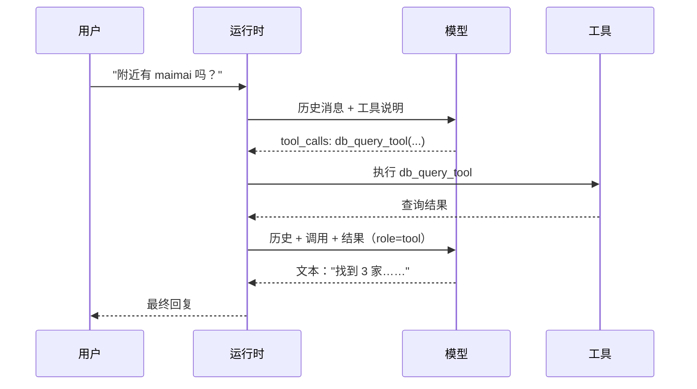
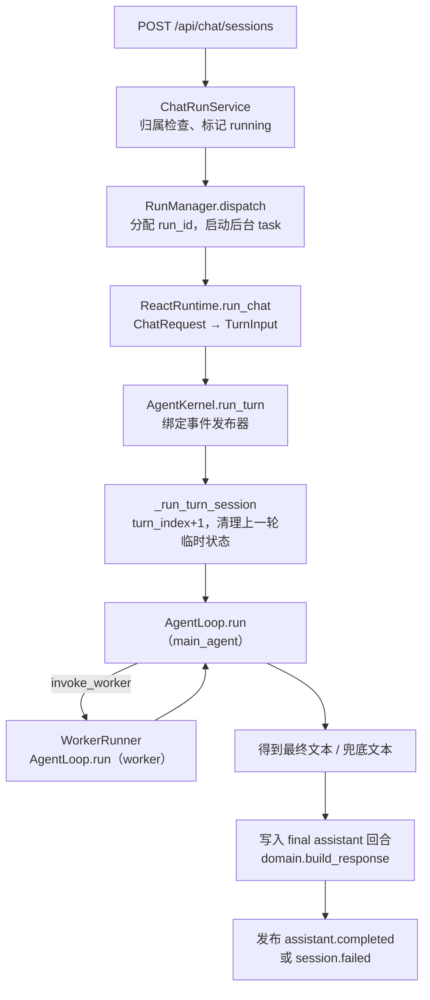
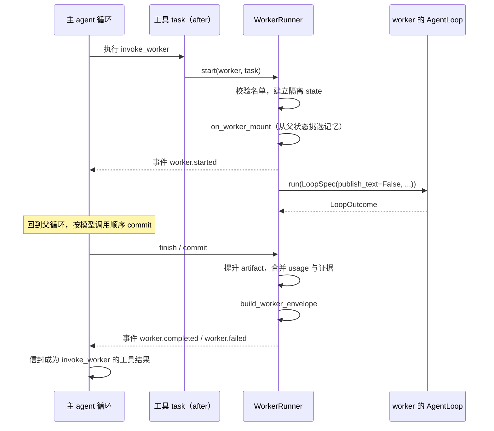
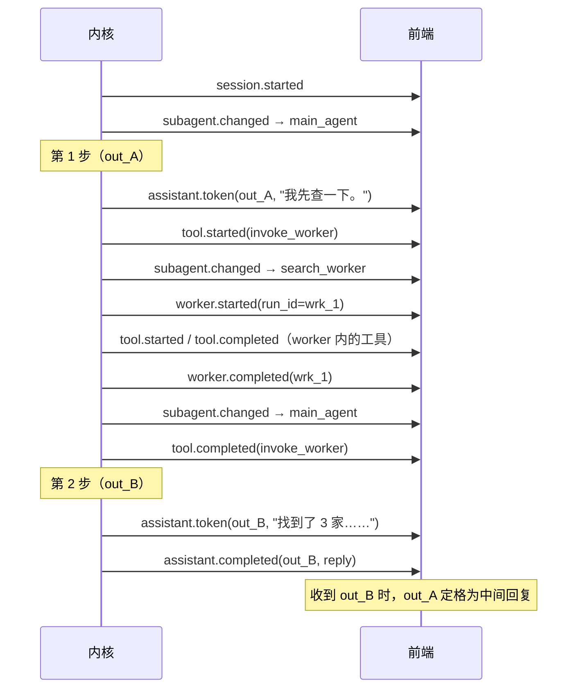

# ReAct 运行时核心逻辑

本文面向第一次阅读 Arcadegent 后端的开发者，说明“用户发一句话之后，Agent 是怎么一步步得出回复的”。阅读顺序从 ReAct 的基本思想出发，依次展开：

1. [什么是 ReAct](#1-什么是-react)
2. [一次对话的全景](#2-一次对话的全景)
3. [ReAct 循环：`AgentLoop`](#3-react-循环agentloop)
4. [模型如何看见并调用工具](#4-模型如何看见并调用工具)
5. [Artifact：工具产物的存放与展示](#5-artifact工具产物的存放与展示)
6. [多 Agent：主 agent 派发 worker](#6-多-agent主-agent-派发-worker)
7. [生命周期与领域注入](#7-生命周期与领域注入)
8. [并发：工具批次与并行 worker](#8-并发工具批次与并行-worker)
9. [事件与 SSE：前端看到了什么](#9-事件与-sse前端看到了什么)
10. [包边界、已知取舍与配置](#10-包边界已知取舍与配置)

run 的接受、取消和 SSE 传输层细节见 [会话运行生命周期与 SSE](./会话运行生命周期与SSE.md)；工具如何注册见 [动态工具注册实现说明](./动态工具注册实现.md)；`context_payload` 的结构见 [智能体上下文载荷设计](./智能体上下文载荷设计.md)。

### 代码地图

运行时的核心在 `backend/app/agent/runtime/`：

| 文件 | 一句话职责 |
| --- | --- |
| `react_runtime.py` | 应用门面：`ChatRequest` → `TurnInput`，跑一轮内核，返回 `ChatResponse` |
| `kernel.py` | `AgentKernel`：一轮对话（turn）的完整流程、收尾与兜底 |
| `agent_loop.py` | `AgentLoop`：ReAct 循环本身，主 agent 和 worker 共用 |
| `actions.py` | `ToolActions`：执行一批工具调用并记录结果 |
| `supervisor.py` | `LoopSupervisor`：等待一批工具任务、取消时统一清理 |
| `worker_runner.py` | `WorkerRunner`：派发 worker 的隔离执行与有序合并 |
| `budget.py` | `RunBudget`：步数上限 |
| `lifecycle.py` | 作用域、生命周期阶段、hook 分发与状态保护 |
| `domain_port.py` | `TurnDomain` 协议与默认实现 `BaseTurnDomain` |
| `events.py` | 事件发布端口、内核事件名、工具事件 hook |
| `session_state.py` | `AgentSessionState`、`AgentTurn` 与工作记忆辅助函数 |
| `ports.py` | `SessionStore` 存储端口 |

运行时依赖的相邻模块：`agent/llm/`（模型调用与流式解析）、`agent/tools/`（工具注册与执行）、`agent/context/`（上下文构建与证据记录）、`agent/artifacts/`（产物策略）、`agent/subagents/`（agent 配置与拓扑）。机厅业务实现在 `backend/app/domain/arcade/`。

---

## 1. 什么是 ReAct

大模型本身只会“读一段文字，写一段文字”。它不能查数据库，也不能规划路线。ReAct（Reasoning + Acting）是一种让模型借助外部工具完成任务的循环：

1. **思考（Reason）**：把对话历史和可用工具的说明交给模型。
2. **行动（Act）**：模型不直接回答，而是输出一个“工具调用请求”，例如 `db_query_tool({"keyword": "maimai"})`。
3. **观察（Observe）**：程序真正执行这个工具，把结果作为一条新消息追加到对话里。
4. 回到第 1 步，直到模型认为信息足够，输出最终回复。

要点：**模型从不自己执行工具**。它只是按工具的 JSON Schema 写出“我想调用哪个工具、参数是什么”，执行、记账、把结果送回去都是运行时的工作。在 OpenAI 兼容接口中，这个请求就是响应里的 `tool_calls`；结果以 `role: "tool"` 的消息、通过 `tool_call_id` 与调用配对后送回。



Arcadegent 在这个基本循环上加了几件事，也就是本文后面各节的内容：工具产物要能被地图展示（artifact）；复杂任务交给专门的子 agent（worker）；业务语义通过钩子注入，内核保持通用（生命周期与领域）；多个工具可以并发执行；整个过程实时推送给前端（SSE）。

---

## 2. 一次对话的全景

先建立几个层级概念，后文反复使用：

| 层级 | 含义 | 代码中的对应 |
| --- | --- | --- |
| Session（会话） | 一个聊天窗口，跨多次提问保留历史与记忆 | `AgentSessionState`，由 `SessionStore` 持久化 |
| Run（运行） | 用户一次提问触发的一次后台执行，有自己的 `run_id` 和事件流 | `RunManager` 中的一条记录；内核里是 `run_turn` 的一次调用 |
| Turn（回合） | Run 内的一问一答。目前一个 Run 恰好对应一个 Turn | `state.turn_index` 每次 +1 |
| Step（步） | ReAct 循环的一次迭代：调一次模型，再执行它要求的工具 | `AgentLoop.run` 的一次 `while` |
| Worker | 主 agent 派发的子 agent，自己也跑一个完整的 ReAct 循环 | `WorkerRunner` |

一次请求从 HTTP 到内核的调用链：



`AgentKernel.run_turn` 一轮的主要动作（`kernel.py`）：

1. 读取或新建会话状态，校验 `client_id` 归属，状态置为 `running`。
2. `turn_index += 1`，清除上一轮的临时键（`reply`、`last_error`），调用 `ArtifactSink.begin_turn` 清掉上一轮的 turn 级产物。
3. 把用户消息作为 `user` 回合持久化，发布 `session.started`。
4. 用 `main_agent` 的配置跑 `AgentLoop`，拿到 `LoopOutcome`。
5. 没有可用文本时由领域给出兜底回复；把最终回复写成 `payload.final = true` 的 assistant 回合。
6. 由领域把状态投影成应用响应（`build_response`），保存会话，发布 `assistant.completed`（成功）或 `session.failed`（模型错误、步数耗尽）。

---

## 3. ReAct 循环：`AgentLoop`

`agent_loop.py` 的 `AgentLoop.run` 是第 1 节那张图的实现。主 agent 和 worker 用的是同一个循环，差别全部写在 `LoopSpec` 里。

### 3.1 一步做什么

```python
# AgentLoop.run（简化）
while not spec.budget.exhausted:
    step = spec.budget.next()
    try:
        context = context_builder.build(state, request, profile)     # ① 组装上下文
        thought = await think(provider, ThinkRequest(                # ② 调用模型
            instructions=context.instructions,
            messages=context.messages,
            tools=await tool_registry.tool_definitions(allowed_tools=profile.allowed_tools),
            ...))
        response = thought.response
        record_model_call(state, response, ...)                      # ③ 记录证据

        if response.error is not None:                               # ④ 分支
            model_error = response.error; break                      #    模型出错：结束
        if response.tool_calls:
            results = await actions.execute_tool_calls(...)          #    执行工具
            reply = concluding_reply(results)
            if reply: final_text = reply; break                      #    “结束本轮”的工具
            continue                                                 #    否则进入下一步
        if response.text.strip():
            final_text = response.text; break                        #    纯文本：就是最终回复
        # 空文本且无工具调用：不算回答，再试一步
    finally:
        await finish_step(step_ctx)                                  # step 生命周期收尾
```

几个容易忽略的点：

- **工具只在模型调用完整结束后执行。** 即使开启了流式输出，工具参数也是在流结束、拼接完整后统一解析一次。流式只影响文本何时出现在界面上，不影响循环结构。
- **模型出错时，这次响应里的工具调用不会执行。**
- **工具失败不会中断主 agent。** 失败结果同样作为 tool 消息送回模型，模型可以换参数重试或改用其他方式回答。

### 3.2 循环的三种结束方式

| 结束方式 | 条件 | `LoopOutcome.status` |
| --- | --- | --- |
| 文本回复 | 模型返回非空文本且没有工具调用 | `completed` |
| 结束本轮的工具 | 一个声明了 `concludes_turn` 能力的工具成功返回非空 `{"reply": ...}`（目前是 `summary_tool`） | `completed` |
| 异常结束 | 模型返回错误 → `failed`；步数耗尽仍无文本 → `step_limit` | `failed` / `step_limit` |

worker 还多一条规则：循环结束时如果仍有未被后续成功批次“抵消”的工具错误，即使写出了文本也记为 `failed`（见第 6 节）。

### 3.3 主 agent 与 worker 的差别：`LoopSpec`

| 字段 | 主 agent | worker | 作用 |
| --- | --- | --- | --- |
| `state` | 会话状态 | worker 自己的隔离状态 | 循环读写哪个状态 |
| `publish_text` | `True` | `False` | 是否把模型文本推送给前端 |
| `persist` | `True` | `False` | 工具证据是否立即写入会话存储（worker 的证据在结束后一次性并入父会话） |
| `fail_on_tool_error` | `False` | `True` | 未解决的工具错误是否让循环失败 |
| `worker_run_id` | `None` | `wrk_xxx` | 区分不同的 worker 运行 |

### 3.4 步数预算：`RunBudget`

每个循环有自己的步数上限 `AGENT_MAX_STEPS`（默认 20，最小 2）。另外，一轮对话里主 agent 和所有 worker 共享一个总池子，大小为上限的 4 倍。worker 通过 `budget.child()` 得到“自己的上限 + 共享池”，因此无论派发多少 worker，一轮的模型调用总数都有界。

---

## 4. 模型如何看见并调用工具

这一节回答三个问题：模型收到的请求长什么样；它提出的工具调用如何被执行；结果如何回到下一次请求里。

### 4.1 组装上下文：`ContextBuilder`

`agent/context/context_builder.py` 每一步都会重新构建一次上下文，分两部分：

- **instructions（系统指令）**：依次拼接 `system_base.md`、已加载技能的说明、当前 agent 的提示词（如 `main_agent.md`）、浏览器定位信息，以及一段 `Runtime state (JSON)`。这段 JSON 包含会话 id、意图、记忆摘要、已完成 worker 的摘要、`context_payload`（整理过的机厅与路线数据）和最近的工具结果。
- **messages（对话历史）**：从 `state.turns` 中取当前作用域最近的若干回合（`history_turn_limit`），转换成模型消息。主 agent 看 `conversation` 作用域，worker 只看 `worker` 作用域，彼此不可见。截断历史时会回退到某个 user 回合的开头，避免把“工具调用—工具结果”这一对拆开。

**工具列表**来自 `ToolRegistry.tool_definitions(allowed_tools=profile.allowed_tools)`。每个 agent 的可用工具由它的配置决定（`subagents/subagent_builder.py` 中的默认值，可被 `agent/nodes/definitions/*.yaml` 覆盖），例如 `search_worker` 不能调用 `route_plan_tool`，只有 `main_agent` 能调用 `invoke_worker`。执行时 `ToolRegistry` 会再做一次权限检查，模型即使“编造”了名单外的工具也会被拒绝。

### 4.2 调用模型：`think()`

`agent/llm/model_gateway.py` 的 `think` 是唯一的模型调用入口：

```python
async def think(adapter, request, *, on_text=None) -> ThinkResult:
    if on_text is None:                  # worker：不推送文本
        return ThinkResult(await adapter.complete(**kwargs), published=False)
    if not adapter.streaming:            # LLM_STREAM=false：结束后整段推送一次
        response = await adapter.complete(**kwargs)
        on_text(text, "synthetic")
        ...
    # LLM_STREAM=true：边收边推
    return ThinkResult(await collect_stream(adapter.stream(**kwargs), on_text=deliver), published)
```

`ProviderAdapter`（`provider_adapter.py`）负责与 OpenAI 兼容接口通信，支持 Chat Completions 与 Responses 两种协议。流式时，`streaming.py` 中的收集器把 SSE 分片转换成四种标准事件：

| 事件 | 处理 |
| --- | --- |
| `TextDelta(text)` | 立即交给 `on_text`，推送给前端 |
| `ReasoningDelta(text)` | 不推送，只进入证据 |
| `ToolCallDelta(index, ...)` | 不推送；收集器按 index 把参数片段拼接起来 |
| `StreamDone(response)` | 最后一个事件，携带与非流式 `complete()` 同形的 `ModelResponse` |

流结束后，收集器把累积的数据重建成“非流式接口本来会返回的响应体”，因此两种模式共用同一套响应解析。取消 run 时，`CancelledError` 让流生成器关闭，底层 `httpx` 连接随之断开，上游请求停止。

### 4.3 执行一个工具调用

模型返回的每个 `ModelToolCall` 包含 `call_id`、`name`、解析后的 `arguments`、原始参数字符串和可能的 `parse_error`。`tools/execution.py` 的 `ToolDispatcher` 为每个调用创建一个 `asyncio.Task`，在其中依次：

1. **准备参数**：参数解析失败直接判为失败；否则 `ToolRegistry.prepare_arguments` 按 Schema 校验，并可从工作记忆中补全字段（`hydrated_fields`，例如 `summary_tool` 从记忆里取店铺列表，模型不必重复抄写）。
2. **执行**：通过 `ToolRegistry.execute` 调用内建工具或 MCP 工具，得到 `ToolExecutionResult(status, output, artifacts, capabilities, ...)`。
3. 准备失败也会生成一个 `failed` 结果，所以每个 `tool.started` 事件一定有对应的 `tool.completed` 或 `tool.failed`。

调用前后的动作通过 `ToolLifecycleHooks` 注入，`tools` 包本身不依赖 `runtime`：

| hook | 执行位置 | 用途 |
| --- | --- | --- |
| `before` | 提交任务时，按模型调用顺序 | 发布 `tool.started` |
| `after` | 工具自己的 task 内 | 可替换结果、启动并发工作（派发 worker 就在这里启动） |
| `commit` | 父循环协程内，按模型调用顺序 | 合并 worker、发布领域事件和 `tool.completed/failed` |

### 4.4 记录结果并回到模型

每个工具结果由 `ToolActions.record_tool_result` 按以下顺序处理：

1. 写入一个 `role="tool"` 的回合，`call_id` 与模型的调用配对，`content` 为输出 JSON，`payload` 中保存参数证据。
2. 应用 artifact（见第 5 节）。
3. 维护内核记忆：失败时写入 `working_memory["last_error"]`，成功则清除（同一批中前面已有失败时不清除，避免后面的成功掩盖错误）。
4. 触发 step 的 `update` 生命周期钩子，让领域把结果投影进自己的记忆（见第 7 节）。

模型调用本身也会被记录：`record_model_call` 写入一个 assistant 回合，在 `payload.model` 中保存 transcript、usage、工具调用参数、耗时等证据，并累加 `usage_totals`。下一步构建上下文时，这些 assistant 回合（含 `tool_calls`）与 tool 回合按顺序成为 messages，模型由此“看到”自己上一步的调用和结果。

**最终回复不重复发送。** 最终文本既存在于产生它的那次模型证据里，又单独写成一个 `payload.final` 回合（供界面与历史恢复使用）。为避免下一轮请求把同一段文字发两次，该证据回合标记 `payload.model.final_reply = true`，`ContextBuilder` 投影历史时跳过它；没有该标记的旧会话，如果无工具调用的证据文本与紧随其后的 final 回合一致，也按同样规则跳过。失败的模型调用同样不进入历史。

```text
持久化：      user → assistant(证据, final_reply=true) → assistant(final)
下一轮的消息： user → assistant(final)
```

---

## 5. Artifact：工具产物的存放与展示

工具的输出要服务两类读者：模型（下一步推理要用）和界面（地图上要显示店铺、路线）。如果让内核认识“店铺列表”“路线”这些业务字段，内核就和机厅业务绑死了。Artifact 机制把“产出了什么”和“如何存放、展示、传递”分开：工具只声明策略，值对内核完全不透明。

### 5.1 声明一个 artifact

`agent/artifacts/model.py`：

```python
@dataclass(frozen=True)
class Artifact:
    key: str                       # 例如 "shops"、"route"
    value: Any                     # 内核不解释
    display: bool = False          # 是否参与界面展示快照
    scope: "turn" | "session" = "turn"   # 下一轮开始时是否清除
    promote: bool = True           # worker 结束时是否允许提升到父 agent
    append: bool = False           # 追加到已有列表而非替换
    append_key: str | None = None  # 追加时用于去重的字段
    invalidates: tuple[str, ...] = ()    # 新值会让哪些旧值失效
    memory: bool = True            # 目前必须为 True
```

工具执行器在返回值中携带 artifact。例如 `db_query_tool` 的一次搜索：

```python
ToolOutcome(output={...}, artifacts=(
    Artifact("shops", rows, display=True, scope="session",
             invalidates=("selected_shops", "shop", "destination")),   # 新搜索让旧的选择、路线目的地失效
    Artifact("search_candidates", rows, scope="turn", promote=False,
             append=True, append_key="source_id"),                     # worker 局部的候选池
    Artifact("total", total, scope="session"),
))
```

### 5.2 `ArtifactSink`：唯一的策略执行者

`agent/artifacts/sink.py` 的 `ArtifactSink` 是唯一把策略写进 `working_memory` 的地方。值存放在 `working_memory["artifacts"][key]`，策略元数据存放在 `working_memory["artifact_meta"][key]`（`turn_index`、`display`、`scope`、`promote`、`invalidates`、`source_run_id` 等）。

| 方法 | 时机 | 做什么 |
| --- | --- | --- |
| `begin_turn` | 每轮开始，由内核无条件调用 | 删除 `scope="turn"` 的产物；领域可传入 `legacy_keys`，兼容没有 scope 元数据的旧会话 |
| `apply` | 每个工具结果记录时 | 写入值和元数据；处理 `append`；删除被 `invalidates` 的旧值（同一批产生的 key 不会被同批删除） |
| `promote` | worker 合并回父 agent 时 | 只提升 worker 自己产生的、`promote=True` 的产物；失败 worker 提升的值标记 `status="partial"`；记录 `source_run_id` |
| `turn_snapshot` | 写入最终 assistant 回合时 | 本轮确实更新过展示产物才生成快照，存入该回合的 `map_artifacts` |
| `display_snapshot` | 即时响应与会话详情 | session 级产物常驻；turn 级产物取最近一次展示轮的整组，避免新搜索的卡片和旧路线混在一起 |

工具自带 artifact 时优先使用；没有时，内核才调用领域的 `artifacts_from_result` 做过渡映射（目前只有 MCP 结果用到）。

### 5.3 展示如何到达前端

内核只通过 `TurnDomain.turn_display_snapshot` 拿到一个不透明的 dict。机厅领域把快照投影成自己的 `ArcadeDisplay`（`domain/arcade/display.py`），再由 `ArcadePayloadMapper` 映射成接口 DTO。前端地图如何渲染见 [智能体地图结果渲染](./智能体地图结果渲染.md)。

---

## 6. 多 Agent：主 agent 派发 worker

### 6.1 为什么需要 worker

主 agent 负责理解意图、组织回复；查询多家机厅、规划路线这类多步操作交给专门的 worker。这样做的好处是：worker 的提示词和工具集更窄，出错面更小；它的中间过程不会塞满主 agent 的上下文，主 agent 只收到一份结构化的结果信封。

目前有两个 worker：`search_worker`（数据库检索、筛选）和 `navigation_worker`（地理解析、路线规划）。

### 6.2 派发就是一次普通的工具调用

派发 worker 没有特殊语法，就是主 agent 调用工具 `invoke_worker`：

```json
{"worker": "search_worker", "task": "查找上海徐汇区有 maimai 的机厅"}
```

这个工具的执行器只是把参数规范化后原样返回，真正起作用的是它在描述符中声明的能力 `spawn_agent`。内核看到一个声明了 `spawn_agent` 且执行成功的结果，就把输出解释为“启动名为 `worker` 的子 agent，任务是 `task`”。内核只认能力名、不认工具名，换一个工具名同样可以派发。

谁能派发谁属于**拓扑**，由 `AgentNode.spawnable` 决定（`subagents/agent_node.py`、`SubAgentBuilder.node()`）：`main_agent` 可以派发所有 worker，worker 不能再派发。名单外的 worker 或空任务直接返回失败信封，不会产生 `worker.started`。

### 6.3 worker 的一生

`runtime/worker_runner.py` 的 `WorkerRunner` 把一次派发拆成三段，这是 worker 能并行的前提：



| 阶段 | 执行位置 | 做什么 |
| --- | --- | --- |
| `start` | 工具 task 内（可并发） | 校验名单、创建隔离状态、触发 `on_worker_mount`、发布 `worker.started`、跑子循环。**不合并父状态的记忆** |
| `finish` | 父循环协程，按模型调用顺序 | 调用 `commit`；失败或取消时补做证据回写并恢复父状态；保证 `unmounted` 恰好一次 |
| `commit` | 同上 | 提升 artifact、合并非 artifact 字段（`worker_memory_promotions`）、合并 usage、把 worker 证据回写父会话、构造信封、发布 `worker.completed/failed` |

**隔离**：worker 拥有全新的 `AgentSessionState`，只看得到 `worker` 作用域的回合。它需要的父状态信息由领域在 `on_worker_mount` 中显式复制（机厅领域会复制意图和部分记忆）；钩子拿到的 `parent_state` 是只读视图。

**信封**：worker 结束后，主 agent 收到的 `invoke_worker` 工具结果就是领域构造的信封。默认实现（`BaseTurnDomain.build_worker_envelope`）的字段如下，内核另外补上 `usage`：

```json
{"worker": "...", "run_id": "wrk_...", "status": "completed|failed",
 "summary": "...", "result": {...}, "artifacts": {...},
 "missing_fields": [], "error": null, "task": "...", "task_preview": "...", "usage": {...}}
```

`status="failed"` 时这个工具调用记为失败，主 agent 可以据此重试或换一种回答。信封同时追加到父状态的 `working_memory["worker_runs"]`（最多保留 20 条），下一步上下文中的 `worker_runs` 摘要就来自这里。

**worker 何时算失败**：模型出错；步数耗尽；或者循环结束时仍有未恢复的工具错误（之后某一批工具全部成功则视为已恢复）。失败的 worker 仍会提升它已产生的 artifact，但标记为 `partial`。

**派发所有权**：候选列表 `search_candidates` 是 `promote=False` 的 worker 局部值。主 agent 的提示词约定“一个任务只派发一个 worker；派发后不再自己对同一请求调用 `db_query_tool`/`result_selection_tool`”。这是提示词层面的约束，运行时不做隐式兜底。

---

## 7. 生命周期与领域注入

### 7.1 要解决的问题：内核通用，业务可插入

`AgentKernel` 不认识机厅：它不 import `ChatRequest`/`ChatResponse`，不知道“意图”“店铺”“路线”。机厅的语义——每轮判断意图、把工具结果写进业务记忆、给 worker 挑选记忆、生成兜底文案、构造接口响应——都通过一个注入的**领域对象**（`TurnDomain`）进入内核。

应用侧的装配在 `core/container.py`：

```python
artifact_sink = ArtifactSink()
arcade_domain = ArcadeTurnDomain(payload_mapper=..., artifact_sink=artifact_sink)
react_runtime = ReactRuntime(..., domain=arcade_domain, artifacts=artifact_sink)
```

不传 `domain` 时使用 `BaseTurnDomain`，内核仍能完整跑通一轮（`backend/app/tests/integration/test_runtime_kernel_domain.py` 用一个最小的非机厅领域验证了这一点）。

领域对内核的作用分两类，可以类比 Vue：**生命周期钩子负责改状态**（类似 `mounted`、`updated`），**协议函数负责产出数据**（类似 `computed`、`render`）。

### 7.2 作用域与阶段

内核在四个作用域上发出生命周期事件：

```text
Run   一次运行
 └─ Turn   一问一答
     └─ Step   一次 ReAct 迭代
         └─ Worker   子 agent（内部也有自己的 Step）
```

| 阶段 | 含义 |
| --- | --- |
| `create` | 分配状态、校验输入，无外部副作用 |
| `mount` | 绑定环境，本作用域生效 |
| `update` | 每个工具结果记账之后 |
| `before_unmount` | 响应已投影，准备收尾 |
| `unmounted` | 清理；**恰好一次**，放在 `finally` 中，异常和取消也会执行 |
| `error` | 异常或取消路径，不吞掉原始错误 |

`LifecycleDispatcher` 把 `(作用域, 阶段)` 映射到 `BaseLifecycleHooks` 上的具体方法。领域只需覆盖关心的方法，其余默认是空操作，覆盖时也不必调用 `super()`：

| 方法 | 时机 | 典型用途 |
| --- | --- | --- |
| `on_run_create` / `on_run_mount` / `on_run_unmounted` | run 开始与结束 | 观测、资源管理 |
| `on_turn_create` / `on_turn_mount` | 内核重置本轮临时键之后、第一次调模型之前 | 写入本轮领域记忆、判定意图 |
| `on_turn_before_unmount` / `on_turn_unmounted` | 响应已构造 / 回合结束 | 读取 `ctx.response`、记录 |
| `on_step_start` | 每步开始、构建上下文之前 | 调整本步的 `StepPolicy.runtime_hints` |
| `on_step_update` | 每个工具结果经内核记账之后（成功、失败都触发） | 把工具输出投影进领域记忆 |
| `on_step_end` | 每步结束（`finally`） | 清理 |
| `on_worker_mount` / `on_worker_unmounted` | worker 状态创建后、首次调模型前 / worker 结束 | 从只读父状态挑选记忆写入 worker |
| `on_error` | 任意作用域的 `error` 阶段 | 记录错误 |

收尾规则：`create`/`mount`/`update` 的钩子失败会中止当前流程并进入错误卸载；`before_unmount` 失败仍会执行 `unmounted`；`unmounted` 与 `error` 阶段的钩子失败只记录日志，不覆盖主错误。

### 7.3 钩子能看到什么、能改什么

钩子收到一个 `LifecycleContext`（下称 ctx），按作用域分栏：

```text
ctx.env          长生命周期服务：provider、tools、skill_registry（不含会话存储）
ctx.run          RunScope：session_id、state
ctx.turn         TurnScope：turn_index、state、request（应用请求，内核不解释）、final_text
ctx.step         StepScope：index、policy（StepPolicy）、state
ctx.worker       WorkerScope：worker_name、run_id、state、parent_state（只读）
ctx.state        最内层作用域的 state（worker > step > turn > run）
ctx.memory       ctx.state 的 working_memory
ctx.tool_result  update 阶段的工具结果
ctx.response     before_unmount 阶段已投影的响应
```

为了让“钩子可以写状态”不变成后门，内核做了三层保护：

- **`StateView`**：钩子拿到的不是 `AgentSessionState` 本身，而是一个视图。只允许写 `working_memory` 中的领域键和 `intent` 属性；给其他属性赋值会抛 `AttributeError`；读取其他属性返回深拷贝快照，修改不会影响内核。`parent_state` 是只读视图，它的 `working_memory` 返回副本。
- **内核保留键**：`reply`、`last_error`、`usage_totals`、`worker_runs` 由内核维护。dispatcher 在被覆盖的钩子前后比较这些键，发现变化就恢复原值并抛 `LifecycleViolation`，本轮按失败处理。
- **会话存储不在 ctx 中**：钩子无法自行持久化，持久化的时机由内核掌握。

### 7.4 产出数据的协议

`domain_port.py` 中的 `TurnDomain` 由四个小协议组成，`BaseTurnDomain` 给出全部默认实现：

| 协议 | 方法 | 内核何时调用 | 默认行为 |
| --- | --- | --- | --- |
| `TurnMetadata` | `runtime_hints` | 每步调模型前，合并进 provider hints | `{}` |
| | `session_event_fields` | 发布 `session.started` 时 | `{}` |
| | `turn_summary` | 写日志时（不得包含请求或回复原文） | `""` |
| `ToolObserver` | `tool_result_signal` | 工具成功提交时；返回的事件排在 `tool.completed` 之前 | 无事件 |
| | `artifacts_from_result` | 工具未自带 artifact 时 | 无 artifact |
| `WorkerPolicy` | `worker_memory_promotions` | worker 合并时，返回要并入父状态的非 artifact 字段 | `{}` |
| | `build_worker_envelope` | worker 合并时 | 通用信封 |
| `TurnPresenter` | `fallback_reply` | 模型没给出可用文本时 | 通用兜底文案 |
| | `turn_display_snapshot` | 写最终回合时 | `None` |
| | `build_response` | 回合结束时，返回值就是 `run_chat` 的返回值 | `TurnReply` |

内核自己维护、不依赖领域实现的不变量：

| 不变量 | 做法 |
| --- | --- |
| 每轮清除上一轮的 `reply`、`last_error` | `reset_turn_scratch`，在 turn 钩子之前执行 |
| 每轮清除 turn 级产物 | `ArtifactSink.begin_turn` |
| 工具失败写 `last_error`，成功清除 | 记录工具结果时完成 |
| 结束本轮 | 工具声明 `concludes_turn`，输出 `{"reply": str}` |
| 派发 worker | 工具声明 `spawn_agent`，输出 `{"worker", "task"}`；合法名单来自 `AgentNode.spawnable` |

### 7.5 机厅领域如何使用这些接口

`domain/arcade/domain.py` 的 `ArcadeTurnDomain` 是一个完整的例子：

```python
class ArcadeTurnDomain(BaseTurnDomain):
    async def on_turn_mount(self, ctx):        # 改状态：判定意图，写入本轮请求、定位、关键词
        self.intent_policy.classify(ctx.turn.state, ctx.turn.request)
        ...
    async def on_step_update(self, ctx):       # 改状态：把工具结果投影进机厅记忆
        observations.apply_tool_result(state=ctx.state, result=ctx.tool_result, ...)
    async def on_worker_mount(self, ctx):      # 改状态：从只读父状态复制意图与记忆
        ctx.worker.state.intent = ctx.worker.parent_state.intent
        ...
    def tool_result_signal(self, *, state, result):   # 产出数据：domain.arcade.results_ready 事件
        ...
    async def build_response(self, *, session_id, state, final_text):  # 产出数据：ChatResponse
        ...
```

`ArcadePayloadMapper` 这类带缓存和 HTTP 配置的长生命周期服务，作为领域的构造参数注入，不进入内核。原则是：**领域不被削平，内核只携带、不解释**。跨边界的对应关系：

| 领域语义 | 内核看到的形式 |
| --- | --- |
| `ChatRequest` | `TurnInput.request`（不透明） |
| 机厅意图、记忆 | `state.intent`、working_memory 中的领域键、`runtime_hints` |
| 店铺、路线 | `Artifact` |
| `domain.arcade.results_ready` 等事件 | `ToolResultSignal.events` |
| worker 合法名单 | `AgentNode.spawnable` |
| `ChatResponse` | `build_response` 返回的不透明对象 |

---

## 8. 并发：工具批次与并行 worker

模型一次可能返回多个工具调用，例如同时派发 `search_worker` 和 `navigation_worker`。运行时要在“尽量并发”与“结果确定、可复现”之间取得平衡。

### 8.1 执行模式与分段

每个工具在描述符中声明 `execution_mode`：

- `parallel`：可以与相邻的 parallel 调用同时执行。目前是 `list_skills`、`read_skill`、`invoke_worker`。
- `exclusive`（默认）：单独执行，并充当屏障。其余内建工具和全部 MCP 工具都是 exclusive。

`ToolActions` 把一批调用按顺序切段：相邻的 parallel 调用合成一段同时执行，每个 exclusive 调用单独成段。段与段之间严格串行。

```text
模型调用顺序：  read_skill, invoke_worker(A), invoke_worker(B), db_query_tool, read_skill
分段：         [read_skill, worker A, worker B] → [db_query_tool] → [read_skill]
               └──────── 段内并发 ────────┘      └── 屏障 ──┘
```

如果收集执行模式时出错（例如 MCP 描述符不可用），整批降级为 exclusive，保证每个调用仍能得到自己的结果。

### 8.2 执行可以乱序，提交必须有序

一段内的调用各自在 `asyncio.Task` 中运行，完成顺序不确定。但凡是会改变父状态或对外可见的动作——合并 worker、发布 `tool.completed`、写入证据回合、触发 `on_step_update`——都放在 `commit` 阶段，而 commit 在父循环协程中**按模型调用顺序**逐个执行。因此：

- 同样的模型输出总是产生同样顺序的事件流和历史记录；
- 两个 worker 写同一个 artifact 时，以模型调用顺序中靠后的为准，而不是以后完成的为准；
- `_SpawnAgentHook` 的 `after` 只负责在 task 内启动 worker，它的 `commit` 才把结果合并回父状态。

`LoopSupervisor`（`supervisor.py`）负责等待：生产环境使用 `WaitPolicy(mode="all")`，等一段内全部调用结束，再按顺序提交。

### 8.3 并行 worker 时谁是“当前 agent”

前端需要显示“现在是谁在工作”。多个 worker 重叠时，`ActiveWorkerSlots` 为每个父状态维护运行中 worker 的列表：新 worker 启动时成为 `active_subagent`；某个 worker 结束后，取仍在运行的最近启动者；最后一个结束后恢复为 `main_agent`。所有 worker 事件都带 `run_id`（及同值的 `worker_run_id`），前端据此区分它们。

### 8.4 取消与异常

无论是用户取消 run，还是批次中某处抛出异常，`supervisor.cancel_all()` 都会取消所有尚未完成的调用，并为它们生成 `status=failed`、`error.type=cancelled` 的合成结果，保证每个 `tool.started` 都有结束事件，也不会留下悬挂的 asyncio task。取消路径会保留已完成兄弟调用的证据（只记录一次）。

worker 侧：`start` 期间遇到取消会立即收尾（回写已完成的证据、恢复父状态的 `active_subagent`、触发 `unmounted`）；普通异常先暂存，等按顺序 `finish` 时再处理，并转换成 `worker_dispatch_error` 的失败工具结果，主 agent 可以继续本轮。存储或事件发布这类基础设施故障仍会让本轮失败。

其他并发安全点：`SkillExecution.load` 用锁保护“查重—读取—累加字节数”，并行的 `read_skill` 不会重复加载，也不会越过 `max_loaded_bytes`；run 结束时内核清理该状态的 worker slots，避免泄漏。

---

## 9. 事件与 SSE：前端看到了什么

### 9.1 内核如何发布事件

内核从不直接接触 HTTP 连接。`run_turn` 开始时把一个 `RunPublisher` 绑定到 `ContextVar`，嵌套的主 agent、worker、工具 task 都通过 `events.publish(...)` 发布，不需要层层传参；异步子任务会继承这个上下文，并发的不同 run 互不干扰。应用层的 `RunLog` 负责给事件编号、缓存并通过 SSE 推给前端（见 [会话运行生命周期与 SSE](./会话运行生命周期与SSE.md)）。

内核发布 11 种事件（`KernelEvent`）：

| 事件 | 时机 |
| --- | --- |
| `session.started` | 用户回合写入之后 |
| `subagent.changed` | 当前 agent 切换（会话开始、worker 开始或结束） |
| `worker.started` / `worker.completed` / `worker.failed` | worker 启动 / 提交 |
| `tool.started` / `tool.completed` / `tool.failed` | 工具提交执行 / 结果提交 |
| `assistant.token` | 主 agent 的文本增量 |
| `assistant.completed` | 回合成功结束，带完整 `reply` |
| `session.failed` | 模型错误、步数耗尽或执行异常 |

此外还有两类事件：应用事件（目前只有沿用旧名的 `navigation.route_ready`）和领域事件。领域用 `domain_event("arcade", "results_ready")` 声明 `domain.<namespace>.<name>` 形式的名字（两段都必须是小写标识符，否则在声明处抛 `ValueError`），通过 `tool_result_signal` 返回，排在对应的 `tool.completed` 之前发布。前端只处理认识的事件名，其余丢弃。

### 9.2 文本输出与 `output_id`

主 agent 的**每一次模型调用**对应一个新的 `output_id`，这次调用产生的所有文本片段共用它：

- `LLM_STREAM=true`：文本片段随模型生成实时推送，`stream_mode: "provider"`。
- `LLM_STREAM=false`：调用结束后整段推送一次，`stream_mode: "synthetic"`。
- worker 的文本从不推送，只进入证据。
- 如果最终回复不是由某次模型调用直接推送的（`concludes_turn` 工具的回复、兜底文案），内核会用新的 `output_id` 补发一次 `synthetic` 文本。
- `assistant.completed` 携带最终那段输出的 `output_id` 和完整 `reply`。

前端收到新的 `output_id` 时，把上一段定格为“中间回复”。以“先说一句再派发 worker”为例，一轮完整的事件顺序如下：



已知取舍：

- 模型中途出错时，已推送的部分文本仍留在界面上，随后兜底文案以新的 `output_id` 出现。
- 中间文本会被定格保留，因此需要提示词约束主 agent 不在工具调用前输出空洞的客套话。

---

## 10. 包边界、已知取舍与配置

### 10.1 包边界与端口

执行内核模块（`agent/runtime/`、`agent/artifacts/`、`llm/model_gateway.py`、`tools/execution.py`、`context/turn_recorder.py`、`subagents/agent_node.py`）只 import `app.agent.*`。内核需要的外部能力以端口形式定义在 agent 包内：

| 端口 | 定义位置 | 应用侧 |
| --- | --- | --- |
| `SessionStore`（`get_or_create_session`、`save_session`） | `agent/runtime/ports.py` | `infra/db/protocols.SessionStateRepository` 继承它，再补充依赖应用 DTO 的历史列表、详情读取等方法 |
| `RunPublisher`、`NullPublisher` | `agent/runtime/events.py` | `session/injector.py` 再导出 |
| `KernelEvent` | `agent/runtime/events.py` | `session/events.py` 以 `RunEvent` 名称再导出，与 `AppEvent`、`ControlEvent` 组成事件目录 |
| 日志 | `agent/_logging.py` | 只依赖标准库，提供 `get_logger` 与脱敏辅助（`log_ref` 等）；`infra.observability.logger` 复用这些辅助，并负责 handler 与格式化 |

`react_runtime.py` 是唯一允许越界的模块（它需要认识 `ChatRequest`/`ChatResponse`）。`backend/app/tests/integration/test_runtime_package_boundary.py` 用 AST 扫描上述模块（包括 `TYPE_CHECKING` 与函数内导入）守住这条边界。

### 10.2 预留与尚未实现

- `WaitPolicy(mode="first_or_interval")`：接口与单测骨架已就绪，生产只用 `all`。后台工具的占位结果、跨步回送尚未接入，设计说明在 `supervisor.py` 末尾。
- 工具能力 `background`、`programmatic` 只定义了常量，暂无运行时行为；`ToolLifecycleHooks.on_update`（部分结果）暂未调用。
- `Artifact(memory=False)`（只展示、不进记忆）暂不支持，`apply` 会直接报错，避免静默丢数据。
- `StepPolicy` 目前只有 `runtime_hints`；临时收紧工具、按步切换模型等能力到真正接入时再加。
- 只支持注入一个领域。接入第二个领域前，需要先实现“按注册顺序挂载、逆序卸载”，因为可写钩子的执行顺序会影响结果。
- `working_memory` 尚未拆分内核区与领域区，目前依靠保留键检查保护。

### 10.3 配置

| 配置 | 默认 | 作用 |
| --- | --- | --- |
| `LLM_STREAM`（或 provider profile 的 `stream`） | `false` | 是否流式调用模型。关闭时界面仍按 `output_id` 规则展示，只是每段文本在调用结束后一次性出现 |
| `AGENT_MAX_STEPS` | `20` | 单个循环的步数上限；一轮的总预算为它的 4 倍 |

### 10.4 相关测试

| 测试 | 覆盖 |
| --- | --- |
| `backend/app/tests/integration/test_runtime_kernel_domain.py` | 用 `BaseTurnDomain` 和最小非机厅领域直接跑 `AgentKernel.run_turn` |
| `backend/app/tests/integration/test_runtime_kernel_golden.py` | 典型场景的事件序列与持久化结果 |
| `backend/app/tests/integration/test_runtime_stream_output.py` | 流式输出与 `output_id` 规则 |
| `backend/app/tests/integration/test_runtime_artifacts.py` | artifact 的作用域、失效、提升与快照 |
| `backend/app/tests/integration/test_worker_runner.py` | worker 取消后的父状态恢复、证据只写一次、`commit` 幂等、派发异常转为失败结果 |
| `backend/app/tests/integration/test_runtime_supervisor.py` | 并行分段、按模型顺序提交、取消清理 |
| `backend/app/tests/integration/test_runtime_package_boundary.py` | 内核模块的 import 边界 |

共享的测试替身在 `backend/app/tests/integration/_runtime_kernel_test_support.py`。
