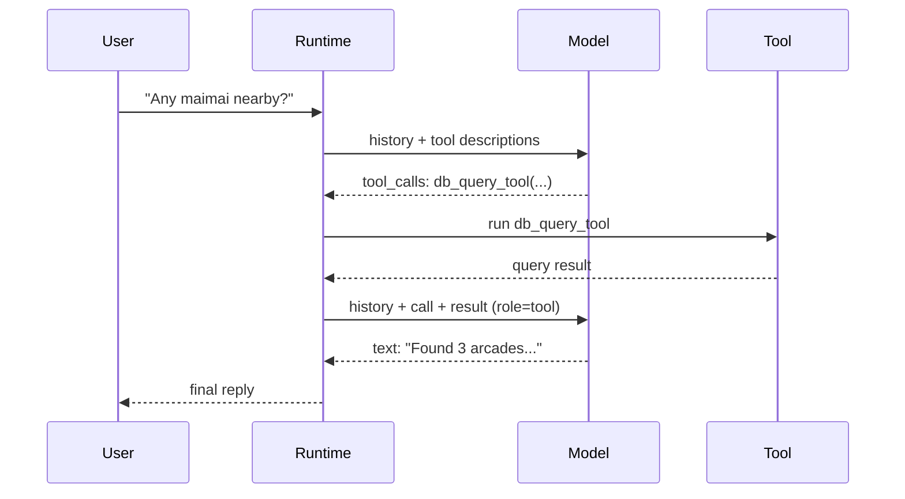
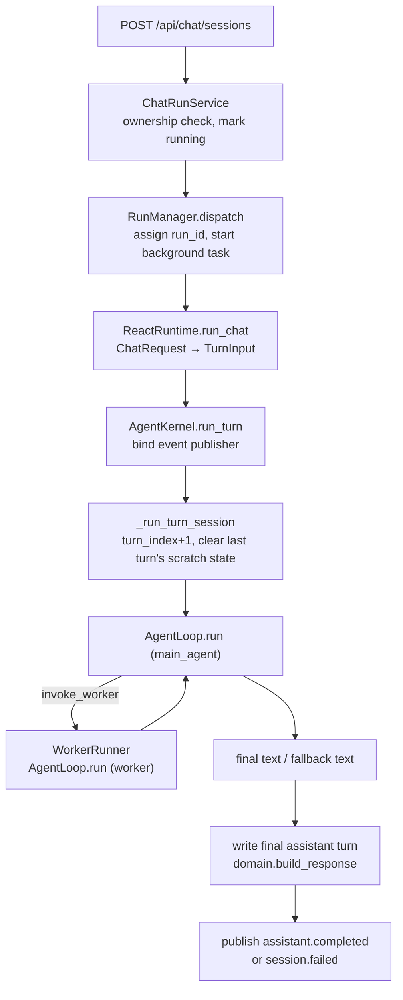
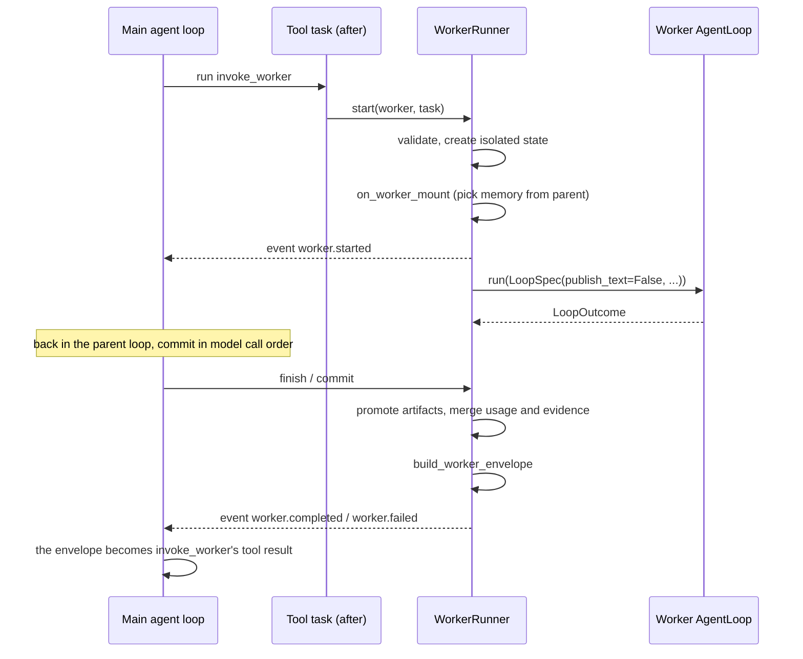
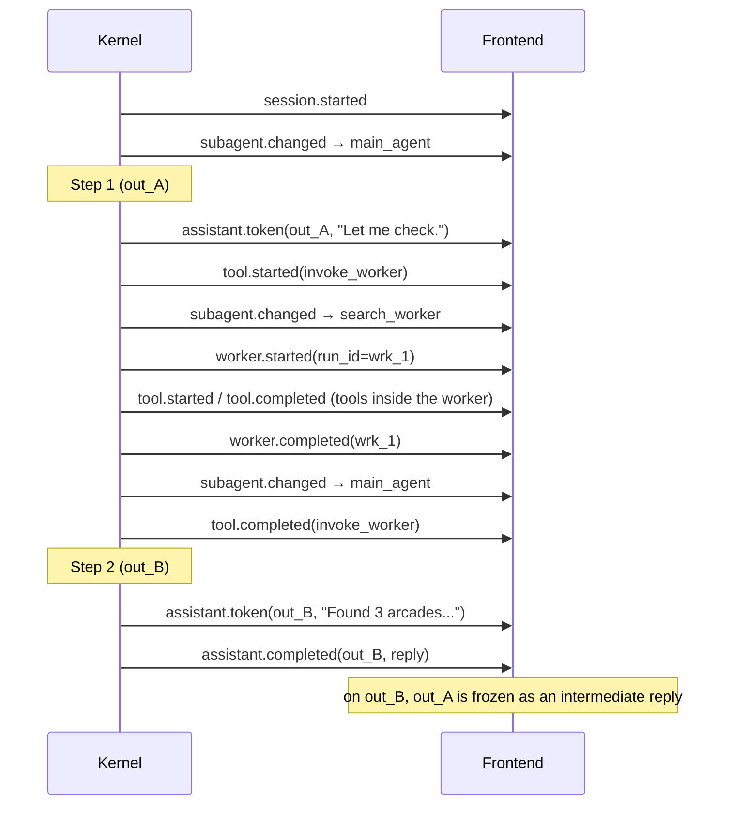

# ReAct Runtime Core Logic

This note is for developers reading the Arcadegent backend for the first time. It explains how the agent gets from a user's message to a reply. It starts from the basic idea of ReAct and then covers:

1. [What ReAct is](#1-what-react-is)
2. [One conversation end to end](#2-one-conversation-end-to-end)
3. [The ReAct loop: `AgentLoop`](#3-the-react-loop-agentloop)
4. [How the model sees and calls tools](#4-how-the-model-sees-and-calls-tools)
5. [Artifacts: storing and displaying tool output](#5-artifacts-storing-and-displaying-tool-output)
6. [Multiple agents: the main agent dispatches workers](#6-multiple-agents-the-main-agent-dispatches-workers)
7. [Lifecycle and domain injection](#7-lifecycle-and-domain-injection)
8. [Concurrency: tool batches and parallel workers](#8-concurrency-tool-batches-and-parallel-workers)
9. [Events and SSE: what the frontend sees](#9-events-and-sse-what-the-frontend-sees)
10. [Package boundaries, trade-offs and configuration](#10-package-boundaries-trade-offs-and-configuration)

For how runs are accepted and cancelled and how the SSE transport works, see [Session Run Lifecycle and SSE](./会话运行生命周期与SSE.md). For tool registration, see [Dynamic Tool Registration](./动态工具注册实现.md). For the shape of `context_payload`, see [Agent Context Payload Design](./智能体上下文载荷设计.md).

### Code map

The runtime lives in `backend/app/agent/runtime/`:

| File | Responsibility |
| --- | --- |
| `react_runtime.py` | Application facade: `ChatRequest` → `TurnInput`, run one kernel turn, return `ChatResponse` |
| `kernel.py` | `AgentKernel`: the full flow of one turn, including wrap-up and fallback |
| `agent_loop.py` | `AgentLoop`: the ReAct loop itself, shared by the main agent and workers |
| `actions.py` | `ToolActions`: run a batch of tool calls and record the results |
| `supervisor.py` | `LoopSupervisor`: wait for a batch of tool tasks and clean up on cancellation |
| `worker_runner.py` | `WorkerRunner`: isolated worker execution and ordered merge into the parent |
| `budget.py` | `RunBudget`: step limits |
| `lifecycle.py` | Scopes, lifecycle phases, hook dispatch and state protection |
| `domain_port.py` | The `TurnDomain` protocols and the default `BaseTurnDomain` |
| `events.py` | Event publishing port, kernel event names, tool event hooks |
| `session_state.py` | `AgentSessionState`, `AgentTurn` and working-memory helpers |
| `ports.py` | The `SessionStore` storage port |

Neighboring modules the runtime uses: `agent/llm/` (model calls and stream parsing), `agent/tools/` (tool registry and execution), `agent/context/` (context building and evidence recording), `agent/artifacts/` (artifact policies), `agent/subagents/` (agent profiles and topology). The arcade business logic lives in `backend/app/domain/arcade/`.

---

## 1. What ReAct is

A language model on its own can only read text and write text. It cannot query a database or plan a route. ReAct (Reasoning + Acting) is a loop that lets a model use external tools:

1. **Reason**: give the model the conversation history and descriptions of the available tools.
2. **Act**: instead of answering, the model outputs a tool call request, for example `db_query_tool({"keyword": "maimai"})`.
3. **Observe**: the program actually runs the tool and appends the result to the conversation as a new message.
4. Go back to step 1 until the model has enough information and writes the final reply.

The key point: **the model never runs a tool itself**. Following each tool's JSON Schema, it only writes which tool it wants and with which arguments. Running the tool, bookkeeping and sending the result back are the runtime's job. In OpenAI-compatible APIs, the request is the `tool_calls` field of the response, and the result goes back as a `role: "tool"` message paired with the call through `tool_call_id`.



Arcadegent adds a few things on top of this basic loop, which the rest of this note covers: tool output must be displayable on a map (artifacts); complex tasks go to dedicated sub-agents (workers); business semantics are injected through hooks so the kernel stays generic (lifecycle and domain); several tools can run concurrently; and the whole process is streamed to the frontend (SSE).

---

## 2. One conversation end to end

A few levels used throughout this note:

| Level | Meaning | In the code |
| --- | --- | --- |
| Session | One chat window; keeps history and memory across questions | `AgentSessionState`, persisted through `SessionStore` |
| Run | One background execution triggered by one user message, with its own `run_id` and event stream | A record in `RunManager`; one `run_turn` call in the kernel |
| Turn | One question and its answer. Currently one run is exactly one turn | `state.turn_index` increases by 1 |
| Step | One iteration of the ReAct loop: one model call, then the tools it asked for | One `while` iteration of `AgentLoop.run` |
| Worker | A sub-agent dispatched by the main agent; it runs its own full ReAct loop | `WorkerRunner` |

The call chain from HTTP to the kernel:



What `AgentKernel.run_turn` does in one turn (`kernel.py`):

1. Load or create the session state, check `client_id` ownership, set the status to `running`.
2. `turn_index += 1`, clear last turn's scratch keys (`reply`, `last_error`), and call `ArtifactSink.begin_turn` to drop last turn's turn-scoped artifacts.
3. Persist the user message as a `user` turn and publish `session.started`.
4. Run `AgentLoop` with the `main_agent` profile and get a `LoopOutcome`.
5. If there is no usable text, the domain supplies a fallback reply. The final reply is written as an assistant turn with `payload.final = true`.
6. The domain projects the state into the application response (`build_response`); the session is saved; `assistant.completed` (success) or `session.failed` (model error, step budget exhausted) is published.

---

## 3. The ReAct loop: `AgentLoop`

`AgentLoop.run` in `agent_loop.py` implements the diagram in section 1. The main agent and workers use the same loop; everything that differs is in `LoopSpec`.

### 3.1 What one step does

```python
# AgentLoop.run (simplified)
while not spec.budget.exhausted:
    step = spec.budget.next()
    try:
        context = context_builder.build(state, request, profile)     # ① build context
        thought = await think(provider, ThinkRequest(                # ② call the model
            instructions=context.instructions,
            messages=context.messages,
            tools=await tool_registry.tool_definitions(allowed_tools=profile.allowed_tools),
            ...))
        response = thought.response
        record_model_call(state, response, ...)                      # ③ record evidence

        if response.error is not None:                               # ④ branch
            model_error = response.error; break                      #    model error: stop
        if response.tool_calls:
            results = await actions.execute_tool_calls(...)          #    run tools
            reply = concluding_reply(results)
            if reply: final_text = reply; break                      #    a turn-concluding tool
            continue                                                 #    otherwise next step
        if response.text.strip():
            final_text = response.text; break                        #    plain text: the final reply
        # blank text and no tool calls is not an answer: try another step
    finally:
        await finish_step(step_ctx)                                  # step lifecycle wrap-up
```

Points that are easy to miss:

- **Tools run only after the model call has fully finished.** Even with streaming on, tool arguments are parsed once, after the stream ends and the fragments are joined. Streaming only changes when text appears in the UI, not the shape of the loop.
- **When the model returns an error, the tool calls in that response are not run.**
- **A tool failure does not stop the main agent.** The failed result goes back to the model as a tool message too, so the model can retry with other arguments or answer another way.

### 3.2 Three ways the loop ends

| How | Condition | `LoopOutcome.status` |
| --- | --- | --- |
| Text reply | The model returns non-blank text and no tool calls | `completed` |
| Turn-concluding tool | A tool that declares the `concludes_turn` capability succeeds with a non-blank `{"reply": ...}` (currently `summary_tool`) | `completed` |
| Abnormal end | The model returns an error → `failed`; the step budget runs out with no text → `step_limit` | `failed` / `step_limit` |

Workers have one more rule: if a tool error is still unresolved when the loop ends (no later batch succeeded cleanly), the worker is `failed` even if it wrote text (see section 6).

### 3.3 Main agent vs. worker: `LoopSpec`

| Field | Main agent | Worker | Effect |
| --- | --- | --- | --- |
| `state` | The session state | The worker's own isolated state | Which state the loop reads and writes |
| `publish_text` | `True` | `False` | Whether model text is pushed to the frontend |
| `persist` | `True` | `False` | Whether tool evidence is saved to the session store immediately (worker evidence is merged into the parent session once, at the end) |
| `fail_on_tool_error` | `False` | `True` | Whether an unresolved tool error fails the loop |
| `worker_run_id` | `None` | `wrk_xxx` | Distinguishes worker runs |

### 3.4 Step budget: `RunBudget`

Each loop has its own step limit, `AGENT_MAX_STEPS` (default 20, minimum 2). In addition, the main agent and all workers of one turn share a pool four times that size. A worker gets `budget.child()`, which has its own limit but draws from the shared pool, so a turn's total number of model calls is bounded no matter how many workers run.

---

## 4. How the model sees and calls tools

This section answers three questions: what the model receives; how its tool calls are run; and how the results get into the next request.

### 4.1 Building the context: `ContextBuilder`

`agent/context/context_builder.py` rebuilds the context on every step. It has two parts:

- **instructions (system prompt)**: `system_base.md`, the instructions of loaded skills, the current agent's prompt (for example `main_agent.md`), browser location info, and a `Runtime state (JSON)` block. That JSON carries the session id, intent, a memory summary, summaries of finished workers, `context_payload` (curated arcade and route data) and recent tool results.
- **messages (history)**: the most recent turns of the current scope in `state.turns` (`history_turn_limit`), converted into model messages. The main agent sees the `conversation` scope; workers see only the `worker` scope; neither sees the other. When history is truncated, the cut moves back to the start of a user turn so a tool call and its result are never separated.

**The tool list** comes from `ToolRegistry.tool_definitions(allowed_tools=profile.allowed_tools)`. Each agent's tools are set by its profile (defaults in `subagents/subagent_builder.py`, overridable by `agent/nodes/definitions/*.yaml`). For example, `search_worker` cannot call `route_plan_tool`, and only `main_agent` can call `invoke_worker`. `ToolRegistry` checks permissions again at execution time, so a tool the model "invents" outside its list is rejected.

### 4.2 Calling the model: `think()`

`think` in `agent/llm/model_gateway.py` is the only entry for model calls:

```python
async def think(adapter, request, *, on_text=None) -> ThinkResult:
    if on_text is None:                  # worker: no text is pushed
        return ThinkResult(await adapter.complete(**kwargs), published=False)
    if not adapter.streaming:            # LLM_STREAM=false: push the whole text once, at the end
        response = await adapter.complete(**kwargs)
        on_text(text, "synthetic")
        ...
    # LLM_STREAM=true: push as it arrives
    return ThinkResult(await collect_stream(adapter.stream(**kwargs), on_text=deliver), published)
```

`ProviderAdapter` (`provider_adapter.py`) talks to OpenAI-compatible APIs and supports both Chat Completions and Responses. When streaming, the collectors in `streaming.py` turn SSE chunks into four normalized events:

| Event | Handling |
| --- | --- |
| `TextDelta(text)` | Passed to `on_text` right away and pushed to the frontend |
| `ReasoningDelta(text)` | Not pushed; evidence only |
| `ToolCallDelta(index, ...)` | Not pushed; the collector joins argument fragments by index |
| `StreamDone(response)` | The last event, carrying a `ModelResponse` of the same shape as non-streaming `complete()` |

When the stream ends, the collector rebuilds the body the non-streaming endpoint would have returned, so both modes share one response parser. When a run is cancelled, `CancelledError` closes the stream generator, which closes the underlying `httpx` connection and stops the upstream request.

### 4.3 Running one tool call

Each `ModelToolCall` from the model carries `call_id`, `name`, parsed `arguments`, the raw argument string and a possible `parse_error`. `ToolDispatcher` in `tools/execution.py` creates one `asyncio.Task` per call, which:

1. **Prepares arguments**: a parse error fails the call right away; otherwise `ToolRegistry.prepare_arguments` validates against the schema and may fill fields from working memory (`hydrated_fields`; for example `summary_tool` takes the shop list from memory so the model does not have to copy it).
2. **Executes**: calls the built-in or MCP tool through `ToolRegistry.execute` and gets a `ToolExecutionResult(status, output, artifacts, capabilities, ...)`.
3. A preparation failure still produces a `failed` result, so every `tool.started` event has a matching `tool.completed` or `tool.failed`.

Actions around a call are injected through `ToolLifecycleHooks`; the `tools` package does not depend on `runtime`:

| Hook | Where it runs | Purpose |
| --- | --- | --- |
| `before` | At submission, in model call order | Publish `tool.started` |
| `after` | Inside the call's own task | May replace the result or start concurrent work (this is where a worker is started) |
| `commit` | In the parent loop coroutine, in model call order | Merge workers, publish domain events and `tool.completed/failed` |

### 4.4 Recording the result and feeding it back

`ToolActions.record_tool_result` handles each tool result in this order:

1. Append a `role="tool"` turn. Its `call_id` pairs it with the model's call, `content` is the output JSON, and `payload` keeps the argument evidence.
2. Apply artifacts (section 5).
3. Maintain kernel memory: a failure writes `working_memory["last_error"]`; a success clears it (unless an earlier call in the same batch failed, so a later success does not hide that error).
4. Fire the step `update` lifecycle hook so the domain can project the result into its own memory (section 7).

The model call itself is recorded as well: `record_model_call` appends an assistant turn whose `payload.model` holds the transcript, usage, tool-call arguments, timings and other evidence, and adds to `usage_totals`. On the next step these assistant turns (with their `tool_calls`) and the tool turns become messages in order, which is how the model "sees" its previous calls and their results.

**The final reply is not sent twice.** The final text exists both in the model evidence that produced it and in a separate `payload.final` turn used by the UI and history restore. So that the next request does not carry the same text twice, that evidence turn is marked `payload.model.final_reply = true` and `ContextBuilder` skips it when projecting history. For older sessions without the marker, evidence without tool calls whose text matches the immediately following final turn is skipped the same way. Failed model calls are also left out of history.

```text
Persisted:            user → assistant(evidence, final_reply=true) → assistant(final)
Next turn's messages: user → assistant(final)
```

---

## 5. Artifacts: storing and displaying tool output

Tool output has two readers: the model (for its next step) and the UI (the map shows shops and routes). If the kernel knew business fields such as "shop list" or "route", it would be tied to the arcade domain. Artifacts separate what was produced from how it is stored, displayed and passed on: the tool only declares a policy, and the value stays opaque to the kernel.

### 5.1 Declaring an artifact

`agent/artifacts/model.py`:

```python
@dataclass(frozen=True)
class Artifact:
    key: str                       # e.g. "shops", "route"
    value: Any                     # never interpreted by the kernel
    display: bool = False          # part of the UI display snapshot?
    scope: "turn" | "session" = "turn"   # dropped when the next turn starts?
    promote: bool = True           # may a finished worker promote it to the parent?
    append: bool = False           # append to an existing list instead of replacing
    append_key: str | None = None  # field used to de-duplicate appended rows
    invalidates: tuple[str, ...] = ()    # older values this new value makes stale
    memory: bool = True            # must be True for now
```

A tool executor returns artifacts with its output. For example, one `db_query_tool` search:

```python
ToolOutcome(output={...}, artifacts=(
    Artifact("shops", rows, display=True, scope="session",
             invalidates=("selected_shops", "shop", "destination")),   # a new search invalidates the old selection and destination
    Artifact("search_candidates", rows, scope="turn", promote=False,
             append=True, append_key="source_id"),                     # worker-local candidate pool
    Artifact("total", total, scope="session"),
))
```

### 5.2 `ArtifactSink`: the only place policies are applied

`ArtifactSink` in `agent/artifacts/sink.py` is the only code that writes artifact policy into `working_memory`. Values live in `working_memory["artifacts"][key]`; policy metadata lives in `working_memory["artifact_meta"][key]` (`turn_index`, `display`, `scope`, `promote`, `invalidates`, `source_run_id`, ...).

| Method | When | What it does |
| --- | --- | --- |
| `begin_turn` | At every turn start, called by the kernel unconditionally | Drops `scope="turn"` artifacts; a domain may pass `legacy_keys` for old sessions without scope metadata |
| `apply` | When each tool result is recorded | Writes values and metadata; handles `append`; drops values named in `invalidates` (keys produced in the same batch are not dropped by that batch) |
| `promote` | When a worker merges into its parent | Promotes only artifacts the worker produced itself with `promote=True`; values from a failed worker are marked `status="partial"`; records `source_run_id` |
| `turn_snapshot` | When the final assistant turn is written | Produces a snapshot only if this turn updated a displayed artifact; stored as that turn's `map_artifacts` |
| `display_snapshot` | Immediate response and session detail | Session-scoped artifacts always included; turn-scoped artifacts taken as a group from the latest display turn, so new search cards never mix with an old route |

Artifacts returned by the tool take precedence. Only when a tool returns none does the kernel call the domain's `artifacts_from_result` as a transitional mapping (today only MCP results use it).

### 5.3 How display data reaches the frontend

The kernel only gets an opaque dict through `TurnDomain.turn_display_snapshot`. The arcade domain projects the snapshot into its own `ArcadeDisplay` (`domain/arcade/display.py`), and `ArcadePayloadMapper` maps it to API DTOs. For how the map renders it, see [Agent Map Result Rendering](./智能体地图结果渲染.md).

---

## 6. Multiple agents: the main agent dispatches workers

### 6.1 Why workers

The main agent understands intent and composes the reply. Multi-step work such as searching several arcades or planning a route goes to a dedicated worker. A worker has a narrower prompt and tool set, so there is less to get wrong, and its intermediate steps do not fill the main agent's context: the main agent only receives a structured result envelope.

There are two workers today: `search_worker` (database search and filtering) and `navigation_worker` (geocoding and route planning).

### 6.2 Dispatch is an ordinary tool call

There is no special syntax for dispatching a worker. The main agent calls the `invoke_worker` tool:

```json
{"worker": "search_worker", "task": "Find arcades with maimai in Xuhui, Shanghai"}
```

The tool's executor just normalizes and returns its arguments. What matters is the `spawn_agent` capability declared in its descriptor. When the kernel sees a successful result from a tool with `spawn_agent`, it reads the output as "start the sub-agent named `worker` with task `task`". The kernel looks at the capability, not the tool name, so a tool with another name could dispatch workers too.

Who may dispatch whom is **topology**, defined by `AgentNode.spawnable` (`subagents/agent_node.py`, `SubAgentBuilder.node()`): `main_agent` may dispatch every worker; workers cannot dispatch. An unknown worker or an empty task returns a failure envelope right away, without a `worker.started` event.

### 6.3 A worker's life

`WorkerRunner` in `runtime/worker_runner.py` splits one dispatch into three stages. This split is what makes parallel workers possible:



| Stage | Where it runs | What it does |
| --- | --- | --- |
| `start` | Inside the tool task (may overlap) | Validate, create the isolated state, fire `on_worker_mount`, publish `worker.started`, run the child loop. **Does not merge into the parent's memory** |
| `finish` | Parent loop coroutine, in model call order | Call `commit`; on failure or cancellation, recover evidence and restore the parent; guarantee exactly one `unmounted` |
| `commit` | Same | Promote artifacts, merge non-artifact fields (`worker_memory_promotions`), merge usage, copy worker evidence into the parent session, build the envelope, publish `worker.completed/failed` |

**Isolation**: a worker gets a fresh `AgentSessionState` and sees only `worker`-scope turns. Whatever it needs from the parent, the domain copies explicitly in `on_worker_mount` (the arcade domain copies the intent and part of the memory). The `parent_state` the hook receives is a read-only view.

**Envelope**: when the worker finishes, the main agent receives the domain-built envelope as the result of `invoke_worker`. The default (`BaseTurnDomain.build_worker_envelope`) has these fields; the kernel adds `usage`:

```json
{"worker": "...", "run_id": "wrk_...", "status": "completed|failed",
 "summary": "...", "result": {...}, "artifacts": {...},
 "missing_fields": [], "error": null, "task": "...", "task_preview": "...", "usage": {...}}
```

With `status="failed"` the tool call counts as failed, and the main agent can retry or answer differently. The envelope is also appended to the parent's `working_memory["worker_runs"]` (last 20 kept), which is where the `worker_runs` summary in the next step's context comes from.

**When a worker fails**: the model returns an error; the step budget runs out; or a tool error is still unresolved when the loop ends (a later batch that fully succeeds counts as recovery). A failed worker still promotes the artifacts it produced, marked `partial`.

**Dispatch ownership**: the candidate list `search_candidates` is a worker-local value with `promote=False`. The main agent's prompt says "dispatch one worker per task; after dispatching, do not call `db_query_tool`/`result_selection_tool` yourself for the same request". This is enforced by the prompt; the runtime adds no hidden fallback.

---

## 7. Lifecycle and domain injection

### 7.1 The problem: a generic kernel with pluggable business logic

`AgentKernel` knows nothing about arcades: it does not import `ChatRequest`/`ChatResponse` and has no idea what an "intent", a "shop" or a "route" is. Arcade semantics — classifying intent each turn, writing tool results into business memory, picking memory for workers, writing fallback text, building the API response — enter the kernel through one injected **domain object** (`TurnDomain`).

The application wires it in `core/container.py`:

```python
artifact_sink = ArtifactSink()
arcade_domain = ArcadeTurnDomain(payload_mapper=..., artifact_sink=artifact_sink)
react_runtime = ReactRuntime(..., domain=arcade_domain, artifacts=artifact_sink)
```

Without a `domain`, `BaseTurnDomain` is used and the kernel still completes a turn (`backend/app/tests/integration/test_runtime_kernel_domain.py` checks this with a minimal non-arcade domain).

A domain affects the kernel in two ways, much like Vue: **lifecycle hooks change state** (like `mounted`, `updated`), and **protocol functions produce data** (like `computed`, `render`).

### 7.2 Scopes and phases

The kernel emits lifecycle events in four scopes:

```text
Run   one execution
 └─ Turn   one question and answer
     └─ Step   one ReAct iteration
         └─ Worker   a sub-agent (with its own steps)
```

| Phase | Meaning |
| --- | --- |
| `create` | Allocate state, validate input; no external side effects |
| `mount` | Bind the environment; the scope becomes active |
| `update` | After each tool result has been recorded |
| `before_unmount` | The response is projected; wrapping up |
| `unmounted` | Cleanup; **exactly once**, in a `finally`, also on errors and cancellation |
| `error` | Error or cancellation path; never swallows the original error |

`LifecycleDispatcher` maps `(scope, phase)` to a method on `BaseLifecycleHooks`. A domain overrides only the methods it needs; the rest are no-ops, and overrides do not need to call `super()`:

| Method | When | Typical use |
| --- | --- | --- |
| `on_run_create` / `on_run_mount` / `on_run_unmounted` | Run start and end | Observation, resource management |
| `on_turn_create` / `on_turn_mount` | After the kernel resets turn scratch keys, before the first model call | Write this turn's domain memory, classify intent |
| `on_turn_before_unmount` / `on_turn_unmounted` | Response built / turn ended | Read `ctx.response`, record |
| `on_step_start` | Start of each step, before the context is built | Adjust this step's `StepPolicy.runtime_hints` |
| `on_step_update` | After each tool result has been recorded by the kernel (success or failure) | Project tool output into domain memory |
| `on_step_end` | End of each step (`finally`) | Cleanup |
| `on_worker_mount` / `on_worker_unmounted` | After the worker state is created, before its first model call / worker end | Copy memory from the read-only parent into the worker |
| `on_error` | The `error` phase of any scope | Record the error |

Wrap-up rules: a failing `create`/`mount`/`update` hook aborts and goes through the error unmount; a failing `before_unmount` still runs `unmounted`; failures in `unmounted` and `error` hooks are only logged and never replace the primary error.

### 7.3 What a hook can see and change

A hook receives a `LifecycleContext` (ctx), split by scope:

```text
ctx.env          long-lived services: provider, tools, skill_registry (no session store)
ctx.run          RunScope: session_id, state
ctx.turn         TurnScope: turn_index, state, request (opaque application request), final_text
ctx.step         StepScope: index, policy (StepPolicy), state
ctx.worker       WorkerScope: worker_name, run_id, state, parent_state (read-only)
ctx.state        state of the innermost scope (worker > step > turn > run)
ctx.memory       working_memory of ctx.state
ctx.tool_result  the tool result, in the update phase
ctx.response     the projected response, in before_unmount
```

So that "hooks can write state" does not become a back door, the kernel has three layers of protection:

- **`StateView`**: hooks get a view, not the `AgentSessionState` itself. Only domain keys in `working_memory` and the `intent` attribute are writable; assigning any other attribute raises `AttributeError`; reading other attributes returns deep-copied snapshots, so changing them has no effect on the kernel. `parent_state` is a read-only view whose `working_memory` is a copy.
- **Kernel-owned keys**: `reply`, `last_error`, `usage_totals` and `worker_runs` belong to the kernel. The dispatcher compares them before and after each overridden hook; on any change it restores the old values and raises `LifecycleViolation`, which fails the turn.
- **No session store in ctx**: hooks cannot persist on their own; the kernel decides when to save.

### 7.4 Data-producing protocols

`TurnDomain` in `domain_port.py` is made of four small protocols; `BaseTurnDomain` implements all of them with defaults:

| Protocol | Method | When the kernel calls it | Default |
| --- | --- | --- | --- |
| `TurnMetadata` | `runtime_hints` | Before every model call; merged into provider hints | `{}` |
| | `session_event_fields` | When publishing `session.started` | `{}` |
| | `turn_summary` | For logs (must not contain request or reply content) | `""` |
| `ToolObserver` | `tool_result_signal` | When a successful tool result is committed; its events go before `tool.completed` | no events |
| | `artifacts_from_result` | When the tool returned no artifacts | none |
| `WorkerPolicy` | `worker_memory_promotions` | When a worker merges; non-artifact fields to copy into the parent | `{}` |
| | `build_worker_envelope` | When a worker merges | generic envelope |
| `TurnPresenter` | `fallback_reply` | When the model gave no usable text | generic fallback text |
| | `turn_display_snapshot` | When the final turn is written | `None` |
| | `build_response` | At turn end; its return value is what `run_chat` returns | `TurnReply` |

Invariants the kernel keeps on its own, independent of the domain:

| Invariant | How |
| --- | --- |
| Clear last turn's `reply` and `last_error` | `reset_turn_scratch`, before the turn hooks |
| Drop turn-scoped artifacts | `ArtifactSink.begin_turn` |
| A tool failure sets `last_error`, a success clears it | When tool results are recorded |
| Conclude the turn | A tool declares `concludes_turn` and outputs `{"reply": str}` |
| Dispatch a worker | A tool declares `spawn_agent` and outputs `{"worker", "task"}`; allowed names come from `AgentNode.spawnable` |

### 7.5 How the arcade domain uses these interfaces

`ArcadeTurnDomain` in `domain/arcade/domain.py` is a complete example:

```python
class ArcadeTurnDomain(BaseTurnDomain):
    async def on_turn_mount(self, ctx):        # changes state: classify intent, store request, location, keyword
        self.intent_policy.classify(ctx.turn.state, ctx.turn.request)
        ...
    async def on_step_update(self, ctx):       # changes state: project tool results into arcade memory
        observations.apply_tool_result(state=ctx.state, result=ctx.tool_result, ...)
    async def on_worker_mount(self, ctx):      # changes state: copy intent and memory from the read-only parent
        ctx.worker.state.intent = ctx.worker.parent_state.intent
        ...
    def tool_result_signal(self, *, state, result):   # produces data: the domain.arcade.results_ready event
        ...
    async def build_response(self, *, session_id, state, final_text):  # produces data: ChatResponse
        ...
```

Long-lived services with caches and HTTP settings, such as `ArcadePayloadMapper`, are constructor dependencies of the domain and never enter the kernel. The principle: **the domain is not flattened; the kernel carries values without interpreting them**. How concepts cross the boundary:

| Domain concept | What the kernel sees |
| --- | --- |
| `ChatRequest` | `TurnInput.request` (opaque) |
| Arcade intent and memory | `state.intent`, domain keys in working_memory, `runtime_hints` |
| Shops, routes | `Artifact` |
| Events such as `domain.arcade.results_ready` | `ToolResultSignal.events` |
| Allowed workers | `AgentNode.spawnable` |
| `ChatResponse` | The opaque object returned by `build_response` |

---

## 8. Concurrency: tool batches and parallel workers

The model may return several tool calls at once, for example dispatching `search_worker` and `navigation_worker` together. The runtime balances running things concurrently against keeping results deterministic and reproducible.

### 8.1 Execution modes and segments

Each tool declares an `execution_mode` in its descriptor:

- `parallel`: may run together with adjacent parallel calls. Currently `list_skills`, `read_skill` and `invoke_worker`.
- `exclusive` (default): runs alone and acts as a barrier. All other built-in tools and all MCP tools are exclusive.

`ToolActions` splits a batch into segments in order: adjacent parallel calls form one concurrent segment; each exclusive call is its own segment. Segments run strictly one after another.

```text
Model call order:  read_skill, invoke_worker(A), invoke_worker(B), db_query_tool, read_skill
Segments:          [read_skill, worker A, worker B] → [db_query_tool] → [read_skill]
                   └────── concurrent ──────┘         └─ barrier ─┘
```

If collecting execution modes fails (for example an MCP descriptor is unavailable), the whole batch falls back to exclusive so every call still gets its own result.

### 8.2 Execution may overlap; commits are ordered

Calls in a segment each run in their own `asyncio.Task` and may finish in any order. But everything that changes parent state or is visible outside — merging a worker, publishing `tool.completed`, writing evidence turns, firing `on_step_update` — happens in the `commit` phase, and commits run one by one in the parent loop coroutine **in model call order**. As a result:

- The same model output always produces the same event order and history;
- When two workers write the same artifact, the one later in model call order wins, not the one that finished last;
- `_SpawnAgentHook.after` only starts the worker inside the task; its `commit` merges the result into the parent.

`LoopSupervisor` (`supervisor.py`) does the waiting. Production uses `WaitPolicy(mode="all")`: wait for every call in the segment, then commit in order.

### 8.3 Who is the "current agent" with parallel workers

The frontend shows who is working right now. When workers overlap, `ActiveWorkerSlots` keeps a list of running workers per parent state: a new worker becomes `active_subagent`; when one finishes, the most recently started one still running takes over; when the last one finishes, it goes back to `main_agent`. Every worker event carries `run_id` (and the same value as `worker_run_id`) so the frontend can tell workers apart.

### 8.4 Cancellation and errors

Whether the user cancels the run or something in the batch raises, `supervisor.cancel_all()` cancels every unfinished call and gives each a synthesized result with `status=failed` and `error.type=cancelled`. Every `tool.started` therefore gets a closing event, and no asyncio task is left behind. On cancellation, the evidence of siblings that had already finished is kept (recorded once).

For workers: a cancellation during `start` is cleaned up immediately (finished evidence copied back, the parent's `active_subagent` restored, `unmounted` fired). Other exceptions are stored and handled when `finish` runs in order; they become a failed tool result of type `worker_dispatch_error`, and the main agent can continue the turn. Infrastructure failures such as storage or event publishing errors still fail the turn.

Other concurrency safeguards: `SkillExecution.load` holds a lock around "check duplicate → read → add bytes", so parallel `read_skill` calls neither load twice nor exceed `max_loaded_bytes`. At run end the kernel clears that state's worker slots so none leak.

---

## 9. Events and SSE: what the frontend sees

### 9.1 How the kernel publishes events

The kernel never touches HTTP connections. At the start of `run_turn` it binds a `RunPublisher` to a `ContextVar`; the nested main agent, workers and tool tasks publish through `events.publish(...)` without passing the publisher around. Async child tasks inherit the context, and concurrent runs do not interfere. The application's `RunLog` numbers the events, buffers them and pushes them over SSE (see [Session Run Lifecycle and SSE](./会话运行生命周期与SSE.md)).

The kernel publishes 11 events (`KernelEvent`):

| Event | When |
| --- | --- |
| `session.started` | After the user turn is written |
| `subagent.changed` | The current agent changes (session start, worker start or end) |
| `worker.started` / `worker.completed` / `worker.failed` | Worker start / commit |
| `tool.started` / `tool.completed` / `tool.failed` | Tool submitted / result committed |
| `assistant.token` | A text delta from the main agent |
| `assistant.completed` | The turn ended successfully; carries the full `reply` |
| `session.failed` | Model error, step budget exhausted, or execution error |

There are two other kinds of events: application events (currently only `navigation.route_ready`, kept under its old name) and domain events. A domain declares a name of the form `domain.<namespace>.<name>` with `domain_event("arcade", "results_ready")` (both parts must be lowercase identifiers, otherwise `ValueError` is raised where the name is declared) and returns it from `tool_result_signal`; it is published before the matching `tool.completed`. The frontend handles only event names it knows and drops the rest.

### 9.2 Text output and `output_id`

**Each model call** of the main agent gets a new `output_id`, shared by all text fragments of that call:

- `LLM_STREAM=true`: fragments are pushed as the model generates them, `stream_mode: "provider"`.
- `LLM_STREAM=false`: the whole text is pushed once after the call ends, `stream_mode: "synthetic"`.
- Worker text is never pushed; it is evidence only.
- If the final reply was not pushed directly by a model call (a `concludes_turn` tool's reply, fallback text), the kernel pushes it once as `synthetic` text under a new `output_id`.
- `assistant.completed` carries the `output_id` of the final output and the full `reply`.

When the frontend sees a new `output_id`, it freezes the previous output as an "intermediate reply". For a turn where the agent says something first and then dispatches a worker, the full event order is:



Known trade-offs:

- If the model fails midway, the partial text already pushed stays in the UI, and the fallback text appears under a new `output_id`.
- Intermediate text is kept, so the prompt must keep the main agent from writing empty filler before tool calls.

---

## 10. Package boundaries, trade-offs and configuration

### 10.1 Package boundaries and ports

The kernel modules (`agent/runtime/`, `agent/artifacts/`, `llm/model_gateway.py`, `tools/execution.py`, `context/turn_recorder.py`, `subagents/agent_node.py`) import only `app.agent.*`. External capabilities the kernel needs are defined as ports inside the agent package:

| Port | Defined in | Application side |
| --- | --- | --- |
| `SessionStore` (`get_or_create_session`, `save_session`) | `agent/runtime/ports.py` | `infra/db/protocols.SessionStateRepository` extends it with history listing and detail reads that depend on application DTOs |
| `RunPublisher`, `NullPublisher` | `agent/runtime/events.py` | Re-exported by `session/injector.py` |
| `KernelEvent` | `agent/runtime/events.py` | Re-exported by `session/events.py` as `RunEvent`; together with `AppEvent` and `ControlEvent` it forms the event catalog |
| Logging | `agent/_logging.py` | Standard library only; provides `get_logger` and redaction helpers (`log_ref`, ...); `infra.observability.logger` reuses these helpers and owns handlers and formatting |

`react_runtime.py` is the only module allowed to cross the boundary (it has to know `ChatRequest`/`ChatResponse`). `backend/app/tests/integration/test_runtime_package_boundary.py` scans these modules with the AST (including `TYPE_CHECKING` and function-local imports) to enforce it.

### 10.2 Reserved and not yet implemented

- `WaitPolicy(mode="first_or_interval")`: the interface and unit-test skeleton exist; production uses only `all`. Placeholder results for background tools and delivery across steps are not wired; the design notes are at the end of `supervisor.py`.
- The tool capabilities `background` and `programmatic` are constants only, with no runtime behavior; `ToolLifecycleHooks.on_update` (partial results) is not called yet.
- `Artifact(memory=False)` (display-only, not stored in memory) is not supported; `apply` raises instead of silently dropping data.
- `StepPolicy` only has `runtime_hints`; per-step tool restrictions or model switching will be added when actually needed.
- Only one domain can be injected. Before adding a second one, mount-in-registration-order / unmount-in-reverse-order must be implemented, because the order of writable hooks affects the result.
- `working_memory` is not yet split into kernel and domain areas; the kernel-owned key check protects it for now.

### 10.3 Configuration

| Setting | Default | Effect |
| --- | --- | --- |
| `LLM_STREAM` (or the provider profile's `stream`) | `false` | Whether model calls stream. When off, the UI still follows the `output_id` rules; each output just appears at once after its call ends |
| `AGENT_MAX_STEPS` | `20` | Step limit per loop; a turn's total budget is four times this |

### 10.4 Related tests

| Test | Covers |
| --- | --- |
| `backend/app/tests/integration/test_runtime_kernel_domain.py` | Runs `AgentKernel.run_turn` directly with `BaseTurnDomain` and a minimal non-arcade domain |
| `backend/app/tests/integration/test_runtime_kernel_golden.py` | Event sequences and persisted results for typical scenarios |
| `backend/app/tests/integration/test_runtime_stream_output.py` | Streaming output and the `output_id` rules |
| `backend/app/tests/integration/test_runtime_artifacts.py` | Artifact scope, invalidation, promotion and snapshots |
| `backend/app/tests/integration/test_worker_runner.py` | Parent restore after worker cancellation, evidence written once, idempotent `commit`, dispatch errors turned into failed results |
| `backend/app/tests/integration/test_runtime_supervisor.py` | Parallel segments, model-order commits, cancellation cleanup |
| `backend/app/tests/integration/test_runtime_package_boundary.py` | Import boundaries of the kernel modules |

Shared test doubles live in `backend/app/tests/integration/_runtime_kernel_test_support.py`.
