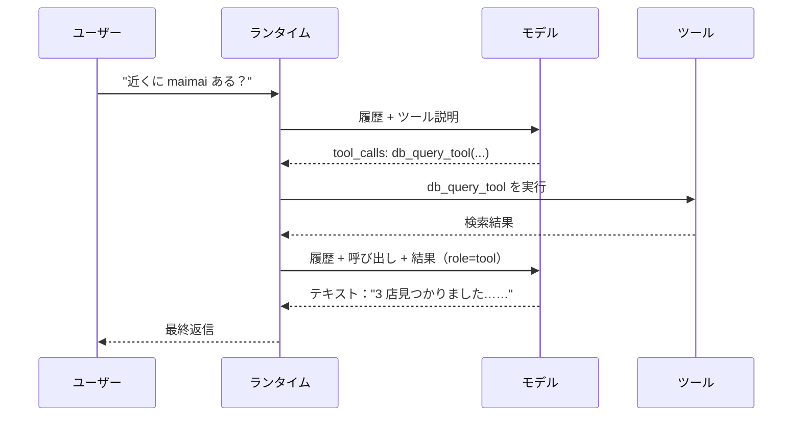
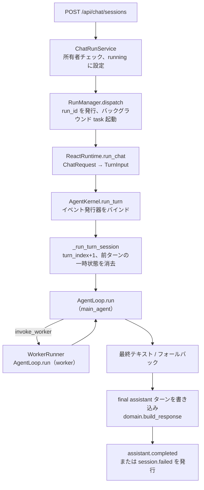
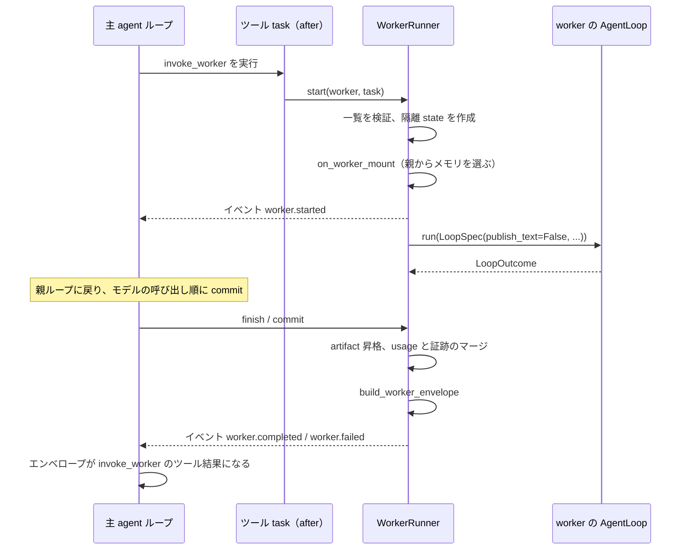
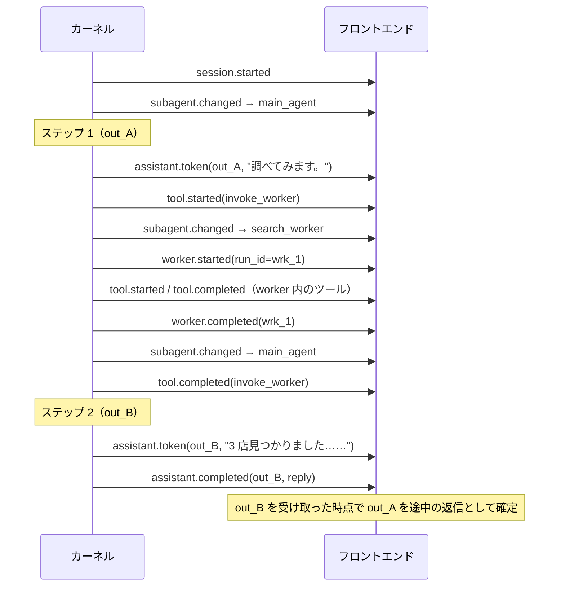

# ReAct ランタイムの中核ロジック

この文書は、Arcadegent のバックエンドを初めて読む開発者向けに、「ユーザーがメッセージを送ってから Agent が返信を出すまで」を説明します。ReAct の基本的な考え方から始め、次の順に説明します。

1. [ReAct とは](#1-react-とは)
2. [1 回の対話の全体像](#2-1-回の対話の全体像)
3. [ReAct ループ：`AgentLoop`](#3-react-ループagentloop)
4. [モデルはどのようにツールを見て呼び出すか](#4-モデルはどのようにツールを見て呼び出すか)
5. [Artifact：ツール出力の保存と表示](#5-artifactツール出力の保存と表示)
6. [マルチ Agent：主 agent が worker を派遣する](#6-マルチ-agent主-agent-が-worker-を派遣する)
7. [ライフサイクルとドメイン注入](#7-ライフサイクルとドメイン注入)
8. [並行実行：ツールバッチと並列 worker](#8-並行実行ツールバッチと並列-worker)
9. [イベントと SSE：フロントエンドに見えるもの](#9-イベントと-sseフロントエンドに見えるもの)
10. [パッケージ境界、既知のトレードオフと設定](#10-パッケージ境界既知のトレードオフと設定)

run の受付・キャンセルと SSE 配信の詳細は [セッション run のライフサイクルと SSE](./会话运行生命周期与SSE.md)、ツール登録は [動的ツール登録の実装記録](./动态工具注册实现.md)、`context_payload` の構造は [Agent コンテキスト payload の設計](./智能体上下文载荷设计.md) を参照してください。

### コードマップ

ランタイムの中核は `backend/app/agent/runtime/` にあります。

| ファイル | 役割 |
| --- | --- |
| `react_runtime.py` | アプリケーションのファサード：`ChatRequest` → `TurnInput`、カーネルで 1 ターン実行し `ChatResponse` を返す |
| `kernel.py` | `AgentKernel`：1 ターンの流れ全体、後処理とフォールバック |
| `agent_loop.py` | `AgentLoop`：ReAct ループ本体。主 agent と worker が共有 |
| `actions.py` | `ToolActions`：ツール呼び出しのバッチを実行し結果を記録 |
| `supervisor.py` | `LoopSupervisor`：ツールタスクのバッチを待機し、キャンセル時にまとめて後始末 |
| `worker_runner.py` | `WorkerRunner`：worker の隔離実行と、親への順序付きマージ |
| `budget.py` | `RunBudget`：ステップ上限 |
| `lifecycle.py` | スコープ、ライフサイクルのフェーズ、hook の配送と状態保護 |
| `domain_port.py` | `TurnDomain` プロトコルとデフォルト実装 `BaseTurnDomain` |
| `events.py` | イベント発行ポート、カーネルイベント名、ツールイベント hook |
| `session_state.py` | `AgentSessionState`、`AgentTurn` と作業メモリの補助関数 |
| `ports.py` | ストレージポート `SessionStore` |

ランタイムが使う周辺モジュール：`agent/llm/`（モデル呼び出しとストリーム解析）、`agent/tools/`（ツール登録と実行）、`agent/context/`（コンテキスト構築と証跡記録）、`agent/artifacts/`（artifact ポリシー）、`agent/subagents/`（agent 設定とトポロジー）。ゲームセンター業務の実装は `backend/app/domain/arcade/` にあります。

---

## 1. ReAct とは

大規模言語モデルそのものは「文章を読み、文章を書く」ことしかできません。データベースを検索することも、ルートを計画することもできません。ReAct（Reasoning + Acting）は、モデルが外部ツールを使ってタスクをこなすためのループです。

1. **考える（Reason）**：対話履歴と利用可能なツールの説明をモデルに渡す。
2. **行動する（Act）**：モデルは直接答えず、「ツール呼び出し要求」を出力する。例：`db_query_tool({"keyword": "maimai"})`。
3. **観察する（Observe）**：プログラムが実際にツールを実行し、結果を新しいメッセージとして対話に追加する。
4. 手順 1 に戻る。情報が十分だとモデルが判断したら最終返信を出力する。

要点：**モデルは自分でツールを実行しません**。ツールの JSON Schema に従って「どのツールをどの引数で呼びたいか」を書くだけで、実行・記録・結果の返送はランタイムの仕事です。OpenAI 互換 API では、この要求はレスポンスの `tool_calls` であり、結果は `role: "tool"` のメッセージとして `tool_call_id` で呼び出しと対応付けて返します。



Arcadegent はこの基本ループにいくつかの仕組みを加えています。以降の各節がその説明です：ツールの出力を地図に表示できること（artifact）、複雑なタスクを専用のサブ agent に任せること（worker）、業務の意味を hook で注入しカーネルを汎用に保つこと（ライフサイクルとドメイン）、複数ツールの並行実行、そして処理全体をリアルタイムでフロントエンドに配信すること（SSE）。

---

## 2. 1 回の対話の全体像

以降で繰り返し使う階層を先に整理します。

| 階層 | 意味 | コード上の対応 |
| --- | --- | --- |
| Session（セッション） | 1 つのチャット画面。複数の質問をまたいで履歴とメモリを保持する | `AgentSessionState`。`SessionStore` で永続化 |
| Run（実行） | ユーザーの 1 回の送信で起動するバックグラウンド実行。固有の `run_id` とイベントストリームを持つ | `RunManager` の 1 レコード。カーネルでは `run_turn` の 1 回の呼び出し |
| Turn（ターン） | Run 内の一問一答。現在は 1 Run がちょうど 1 Turn | `state.turn_index` が 1 増える |
| Step（ステップ） | ReAct ループの 1 反復：モデルを 1 回呼び、要求されたツールを実行する | `AgentLoop.run` の `while` 1 回 |
| Worker | 主 agent が派遣するサブ agent。自身も完全な ReAct ループを回す | `WorkerRunner` |

HTTP からカーネルまでの呼び出し経路：



`AgentKernel.run_turn` が 1 ターンで行う主な処理（`kernel.py`）：

1. セッション状態を読み込むか新規作成し、`client_id` の所有者を確認して状態を `running` にする。
2. `turn_index += 1`。前ターンの一時キー（`reply`、`last_error`）を消し、`ArtifactSink.begin_turn` で前ターンの turn スコープ artifact を削除する。
3. ユーザーメッセージを `user` ターンとして永続化し、`session.started` を発行する。
4. `main_agent` の設定で `AgentLoop` を実行し、`LoopOutcome` を得る。
5. 使えるテキストがなければドメインがフォールバック返信を用意する。最終返信を `payload.final = true` の assistant ターンとして書き込む。
6. ドメインが状態をアプリケーションのレスポンスに射影し（`build_response`）、セッションを保存して、`assistant.completed`（成功）または `session.failed`（モデルエラー、ステップ上限到達）を発行する。

---

## 3. ReAct ループ：`AgentLoop`

`agent_loop.py` の `AgentLoop.run` は第 1 節の図の実装です。主 agent と worker は同じループを使い、違いはすべて `LoopSpec` に書かれています。

### 3.1 1 ステップで行うこと

```python
# AgentLoop.run（簡略版）
while not spec.budget.exhausted:
    step = spec.budget.next()
    try:
        context = context_builder.build(state, request, profile)     # ① コンテキスト構築
        thought = await think(provider, ThinkRequest(                # ② モデル呼び出し
            instructions=context.instructions,
            messages=context.messages,
            tools=await tool_registry.tool_definitions(allowed_tools=profile.allowed_tools),
            ...))
        response = thought.response
        record_model_call(state, response, ...)                      # ③ 証跡を記録

        if response.error is not None:                               # ④ 分岐
            model_error = response.error; break                      #    モデルエラー：終了
        if response.tool_calls:
            results = await actions.execute_tool_calls(...)          #    ツール実行
            reply = concluding_reply(results)
            if reply: final_text = reply; break                      #    「ターンを終える」ツール
            continue                                                 #    それ以外は次のステップへ
        if response.text.strip():
            final_text = response.text; break                        #    テキストのみ：これが最終返信
        # 空テキストかつツール呼び出しなし：回答とみなさず、もう 1 ステップ
    finally:
        await finish_step(step_ctx)                                  # step ライフサイクルの後処理
```

見落としやすい点：

- **ツールはモデル呼び出しが完全に終わってから実行されます。** ストリーミングを有効にしていても、ツール引数はストリーム終了後に結合してから一度だけ解析されます。ストリーミングが変えるのはテキストが画面に出るタイミングだけで、ループの構造は変わりません。
- **モデルがエラーを返したとき、そのレスポンス内のツール呼び出しは実行されません。**
- **ツールの失敗で主 agent は止まりません。** 失敗結果も tool メッセージとしてモデルに返るので、モデルは引数を変えて再試行したり、別の方法で答えたりできます。

### 3.2 ループの 3 つの終わり方

| 終わり方 | 条件 | `LoopOutcome.status` |
| --- | --- | --- |
| テキスト返信 | モデルが空でないテキストを返し、ツール呼び出しがない | `completed` |
| ターンを終えるツール | `concludes_turn` 能力を宣言したツールが成功し、空でない `{"reply": ...}` を返す（現在は `summary_tool`） | `completed` |
| 異常終了 | モデルがエラーを返す → `failed`；ステップを使い切ってもテキストがない → `step_limit` | `failed` / `step_limit` |

worker には追加のルールがあります。ループ終了時に、後続の成功バッチで「打ち消されていない」ツールエラーが残っていれば、テキストを書いていても `failed` になります（第 6 節）。

### 3.3 主 agent と worker の違い：`LoopSpec`

| フィールド | 主 agent | worker | 効果 |
| --- | --- | --- | --- |
| `state` | セッション状態 | worker 専用の隔離状態 | ループがどの状態を読み書きするか |
| `publish_text` | `True` | `False` | モデルのテキストをフロントエンドに送るか |
| `persist` | `True` | `False` | ツールの証跡をすぐセッションストアに保存するか（worker の証跡は終了時に親セッションへまとめてマージ） |
| `fail_on_tool_error` | `False` | `True` | 未解決のツールエラーでループを失敗させるか |
| `worker_run_id` | `None` | `wrk_xxx` | worker の実行を区別する |

### 3.4 ステップ予算：`RunBudget`

各ループには固有のステップ上限 `AGENT_MAX_STEPS`（デフォルト 20、最小 2）があります。さらに 1 ターンの主 agent と全 worker は、上限の 4 倍の共有プールを使います。worker は `budget.child()` で「自分の上限 + 共有プール」を受け取るため、いくつ worker を派遣しても 1 ターンのモデル呼び出し総数には上限があります。

---

## 4. モデルはどのようにツールを見て呼び出すか

この節では 3 つの問いに答えます：モデルが受け取るリクエストはどんな形か、モデルが出したツール呼び出しはどう実行されるか、結果はどう次のリクエストに戻るか。

### 4.1 コンテキストの構築：`ContextBuilder`

`agent/context/context_builder.py` は毎ステップ、コンテキストを作り直します。2 つの部分からなります。

- **instructions（システム指示）**：`system_base.md`、読み込み済みスキルの説明、現在の agent のプロンプト（例：`main_agent.md`）、ブラウザーの位置情報、そして `Runtime state (JSON)` ブロックを順に連結します。この JSON にはセッション id、意図、メモリの要約、完了した worker の要約、`context_payload`（整理済みの店舗・ルートデータ）、最近のツール結果が入ります。
- **messages（対話履歴）**：`state.turns` から現在のスコープの直近ターン（`history_turn_limit`）を取り出し、モデルメッセージに変換します。主 agent は `conversation` スコープ、worker は `worker` スコープだけを見るので、互いに見えません。履歴を切り詰めるときは user ターンの先頭まで戻り、「ツール呼び出しとその結果」の組を分断しません。

**ツール一覧**は `ToolRegistry.tool_definitions(allowed_tools=profile.allowed_tools)` から得ます。各 agent が使えるツールはその設定で決まります（`subagents/subagent_builder.py` のデフォルト値を `agent/nodes/definitions/*.yaml` で上書き可能）。たとえば `search_worker` は `route_plan_tool` を呼べず、`invoke_worker` を呼べるのは `main_agent` だけです。実行時に `ToolRegistry` が権限を再確認するので、モデルが一覧外のツールを「でっち上げて」も拒否されます。

### 4.2 モデルの呼び出し：`think()`

`agent/llm/model_gateway.py` の `think` がモデル呼び出しの唯一の入口です。

```python
async def think(adapter, request, *, on_text=None) -> ThinkResult:
    if on_text is None:                  # worker：テキストを送らない
        return ThinkResult(await adapter.complete(**kwargs), published=False)
    if not adapter.streaming:            # LLM_STREAM=false：終了後にまとめて 1 回送る
        response = await adapter.complete(**kwargs)
        on_text(text, "synthetic")
        ...
    # LLM_STREAM=true：受け取りながら送る
    return ThinkResult(await collect_stream(adapter.stream(**kwargs), on_text=deliver), published)
```

`ProviderAdapter`（`provider_adapter.py`）は OpenAI 互換 API と通信し、Chat Completions と Responses の両プロトコルに対応します。ストリーミング時は `streaming.py` のコレクターが SSE チャンクを 4 種類の標準イベントに変換します。

| イベント | 扱い |
| --- | --- |
| `TextDelta(text)` | すぐ `on_text` に渡し、フロントエンドへ送る |
| `ReasoningDelta(text)` | 送らない。証跡にのみ残す |
| `ToolCallDelta(index, ...)` | 送らない。コレクターが index ごとに引数の断片を結合する |
| `StreamDone(response)` | 最後のイベント。非ストリーミングの `complete()` と同じ形の `ModelResponse` を持つ |

ストリーム終了後、コレクターは蓄積したデータから「非ストリーミング API が本来返したはずのレスポンス本体」を再構築するため、両モードで同じレスポンス解析を共有できます。run がキャンセルされると `CancelledError` でストリームジェネレーターが閉じられ、下層の `httpx` 接続も切れて上流リクエストが止まります。

### 4.3 1 つのツール呼び出しを実行する

モデルが返す各 `ModelToolCall` は `call_id`、`name`、解析済みの `arguments`、元の引数文字列、場合によっては `parse_error` を持ちます。`tools/execution.py` の `ToolDispatcher` は呼び出しごとに `asyncio.Task` を作り、その中で次を行います。

1. **引数の準備**：解析エラーなら即失敗。そうでなければ `ToolRegistry.prepare_arguments` が Schema で検証し、作業メモリからフィールドを補完することもあります（`hydrated_fields`。たとえば `summary_tool` は店舗一覧をメモリから取るので、モデルが書き写す必要がありません）。
2. **実行**：`ToolRegistry.execute` で組み込みツールまたは MCP ツールを呼び、`ToolExecutionResult(status, output, artifacts, capabilities, ...)` を得ます。
3. 準備に失敗しても `failed` の結果が作られるので、すべての `tool.started` には対応する `tool.completed` か `tool.failed` が必ずあります。

呼び出し前後の処理は `ToolLifecycleHooks` で注入され、`tools` パッケージ自体は `runtime` に依存しません。

| hook | 実行場所 | 用途 |
| --- | --- | --- |
| `before` | 投入時、モデルの呼び出し順 | `tool.started` を発行 |
| `after` | そのツール自身の task 内 | 結果の置き換えや並行処理の開始（worker はここで起動） |
| `commit` | 親ループのコルーチン内、モデルの呼び出し順 | worker のマージ、ドメインイベントと `tool.completed/failed` の発行 |

### 4.4 結果を記録してモデルに戻す

各ツール結果は `ToolActions.record_tool_result` が次の順で処理します。

1. `role="tool"` のターンを書き込む。`call_id` でモデルの呼び出しと対応付け、`content` は出力 JSON、`payload` に引数の証跡を保存する。
2. artifact を適用する（第 5 節）。
3. カーネルのメモリを管理する：失敗なら `working_memory["last_error"]` を書き、成功なら消す（同じバッチで先に失敗があれば消さない。後の成功が先のエラーを隠さないようにするため）。
4. step の `update` ライフサイクル hook を呼び、ドメインが結果を自分のメモリに射影できるようにする（第 7 節）。

モデル呼び出し自体も記録されます。`record_model_call` は assistant ターンを書き込み、`payload.model` に transcript、usage、ツール呼び出しの引数、所要時間などの証跡を保存し、`usage_totals` に加算します。次のステップでコンテキストを作るとき、これらの assistant ターン（`tool_calls` を含む）と tool ターンが順に messages になり、モデルは前のステップの呼び出しと結果を「見る」ことができます。

**最終返信は二重に送られません。** 最終テキストは、それを生んだモデル呼び出しの証跡と、画面表示・履歴復元用の `payload.final` ターンの両方に存在します。次のリクエストで同じ文章を 2 回送らないよう、その証跡ターンには `payload.model.final_reply = true` が付き、`ContextBuilder` は履歴を射影するときにそれを飛ばします。このマーカーがない古いセッションでも、ツール呼び出しのない証跡のテキストが直後の final ターンと一致すれば同じく飛ばします。失敗したモデル呼び出しも履歴に入りません。

```text
永続化：             user → assistant(証跡, final_reply=true) → assistant(final)
次ターンのメッセージ：user → assistant(final)
```

---

## 5. Artifact：ツール出力の保存と表示

ツールの出力には 2 種類の読み手がいます。モデル（次のステップの推論に使う）と画面（地図に店舗やルートを表示する）です。カーネルが「店舗一覧」「ルート」といった業務フィールドを知っていると、カーネルはゲームセンター業務に縛られてしまいます。Artifact の仕組みは「何を出力したか」と「どう保存・表示・受け渡しするか」を分けます。ツールはポリシーを宣言するだけで、値はカーネルにとって不透明です。

### 5.1 artifact を宣言する

`agent/artifacts/model.py`：

```python
@dataclass(frozen=True)
class Artifact:
    key: str                       # 例："shops"、"route"
    value: Any                     # カーネルは解釈しない
    display: bool = False          # 画面表示スナップショットに含めるか
    scope: "turn" | "session" = "turn"   # 次のターン開始時に消すか
    promote: bool = True           # worker 終了時に親 agent へ昇格させてよいか
    append: bool = False           # 置き換えずに既存リストへ追記する
    append_key: str | None = None  # 追記時の重複除去に使うフィールド
    invalidates: tuple[str, ...] = ()    # 新しい値によって無効になる古い値
    memory: bool = True            # 現在は True 必須
```

ツールの実行器は戻り値に artifact を含めます。たとえば `db_query_tool` の検索 1 回：

```python
ToolOutcome(output={...}, artifacts=(
    Artifact("shops", rows, display=True, scope="session",
             invalidates=("selected_shops", "shop", "destination")),   # 新しい検索で古い選択・目的地を無効化
    Artifact("search_candidates", rows, scope="turn", promote=False,
             append=True, append_key="source_id"),                     # worker ローカルの候補プール
    Artifact("total", total, scope="session"),
))
```

### 5.2 `ArtifactSink`：ポリシーを適用する唯一の場所

`agent/artifacts/sink.py` の `ArtifactSink` は、artifact のポリシーを `working_memory` に書き込む唯一の場所です。値は `working_memory["artifacts"][key]`、ポリシーのメタデータは `working_memory["artifact_meta"][key]`（`turn_index`、`display`、`scope`、`promote`、`invalidates`、`source_run_id` など）に置かれます。

| メソッド | タイミング | 処理 |
| --- | --- | --- |
| `begin_turn` | 毎ターン開始時、カーネルが無条件に呼ぶ | `scope="turn"` の artifact を削除。scope メタデータのない古いセッション向けに、ドメインが `legacy_keys` を渡せる |
| `apply` | 各ツール結果の記録時 | 値とメタデータを書き込む。`append` を処理。`invalidates` で指定された古い値を削除（同じバッチで作られたキーは削除しない） |
| `promote` | worker が親にマージされるとき | worker 自身が作った `promote=True` の artifact だけを昇格。失敗した worker の値は `status="partial"`。`source_run_id` を記録 |
| `turn_snapshot` | 最終 assistant ターンの書き込み時 | このターンで表示用 artifact を実際に更新した場合だけスナップショットを作り、そのターンの `map_artifacts` に保存 |
| `display_snapshot` | 即時レスポンスとセッション詳細 | session スコープは常に含める。turn スコープは直近の表示ターンの分をまとめて取り、新しい検索のカードと古いルートが混ざらないようにする |

ツールが artifact を返した場合はそれを優先します。返さなかった場合だけ、カーネルは過渡的なマッピングとしてドメインの `artifacts_from_result` を呼びます（現在は MCP の結果だけが使用）。

### 5.3 表示データがフロントエンドに届くまで

カーネルは `TurnDomain.turn_display_snapshot` を通じて不透明な dict を受け取るだけです。ゲームセンタードメインはスナップショットを独自の `ArcadeDisplay`（`domain/arcade/display.py`）に射影し、`ArcadePayloadMapper` が API の DTO に変換します。地図での描画は [Agent の地図結果を描画する](./智能体地图结果渲染.md) を参照してください。

---

## 6. マルチ Agent：主 agent が worker を派遣する

### 6.1 なぜ worker が必要か

主 agent は意図の理解と返信の組み立てを担当し、複数店舗の検索やルート計画のような多段階の作業は専用の worker に任せます。worker はプロンプトとツールが絞られているので間違える余地が小さく、途中経過が主 agent のコンテキストを埋めることもありません。主 agent が受け取るのは構造化された結果エンベロープだけです。

現在の worker は 2 つです：`search_worker`（データベース検索と絞り込み）と `navigation_worker`（ジオコーディングとルート計画）。

### 6.2 派遣は普通のツール呼び出し

worker の派遣に特別な構文はありません。主 agent がツール `invoke_worker` を呼ぶだけです。

```json
{"worker": "search_worker", "task": "上海市徐匯区で maimai がある店を探す"}
```

このツールの実行器は引数を正規化してそのまま返すだけです。意味を持つのは、記述子で宣言された能力 `spawn_agent` です。`spawn_agent` を宣言したツールが成功すると、カーネルはその出力を「`worker` という名前のサブ agent を `task` で起動する」と解釈します。カーネルが見るのは能力名でツール名ではないので、別名のツールでも派遣できます。

誰が誰を派遣できるかは**トポロジー**で、`AgentNode.spawnable` が決めます（`subagents/agent_node.py`、`SubAgentBuilder.node()`）。`main_agent` はすべての worker を派遣でき、worker はさらに派遣できません。一覧外の worker や空のタスクはすぐに失敗エンベロープを返し、`worker.started` は発行されません。

### 6.3 worker の一生

`runtime/worker_runner.py` の `WorkerRunner` は 1 回の派遣を 3 段階に分けます。これが worker を並列に動かせる前提です。



| 段階 | 実行場所 | 処理 |
| --- | --- | --- |
| `start` | ツール task 内（並行しうる） | 一覧の検証、隔離状態の作成、`on_worker_mount`、`worker.started` の発行、子ループの実行。**親のメモリにはマージしない** |
| `finish` | 親ループのコルーチン、モデルの呼び出し順 | `commit` を呼ぶ。失敗・キャンセル時は証跡を回収し親の状態を戻す。`unmounted` をちょうど 1 回保証 |
| `commit` | 同上 | artifact の昇格、artifact 以外のフィールド（`worker_memory_promotions`）のマージ、usage のマージ、worker の証跡を親セッションへ書き戻し、エンベロープの構築、`worker.completed/failed` の発行 |

**隔離**：worker は新しい `AgentSessionState` を持ち、`worker` スコープのターンだけを見ます。親から必要な情報は、ドメインが `on_worker_mount` で明示的にコピーします（ゲームセンタードメインは意図とメモリの一部をコピー）。hook が受け取る `parent_state` は読み取り専用ビューです。

**エンベロープ**：worker が終わると、主 agent は `invoke_worker` のツール結果としてドメインが作ったエンベロープを受け取ります。デフォルト実装（`BaseTurnDomain.build_worker_envelope`）のフィールドは次のとおりで、カーネルが `usage` を追加します。

```json
{"worker": "...", "run_id": "wrk_...", "status": "completed|failed",
 "summary": "...", "result": {...}, "artifacts": {...},
 "missing_fields": [], "error": null, "task": "...", "task_preview": "...", "usage": {...}}
```

`status="failed"` のとき、このツール呼び出しは失敗扱いになり、主 agent は再試行したり別の答え方をしたりできます。エンベロープは親の `working_memory["worker_runs"]`（最新 20 件まで保持）にも追加され、次ステップのコンテキストにある `worker_runs` の要約はここから作られます。

**worker が失敗とみなされる条件**：モデルのエラー、ステップ上限到達、またはループ終了時に未解決のツールエラーが残っていること（その後のバッチがすべて成功すれば回復とみなす）。失敗した worker も作成済みの artifact は昇格しますが、`partial` が付きます。

**派遣の所有権**：候補リスト `search_candidates` は `promote=False` の worker ローカル値です。主 agent のプロンプトは「1 つのタスクには worker を 1 つだけ派遣し、派遣後は同じ要求に対して自分で `db_query_tool`/`result_selection_tool` を呼ばない」と定めています。これはプロンプトでの約束で、ランタイムが暗黙に補うことはしません。

---

## 7. ライフサイクルとドメイン注入

### 7.1 解決したい問題：汎用のカーネルに業務を差し込む

`AgentKernel` はゲームセンターを知りません。`ChatRequest`/`ChatResponse` を import せず、「意図」「店舗」「ルート」が何かも知りません。ゲームセンターの意味づけ——毎ターンの意図判定、ツール結果の業務メモリへの書き込み、worker 用メモリの選択、フォールバック文の生成、API レスポンスの構築——は、注入された 1 つの**ドメインオブジェクト**（`TurnDomain`）を通じてカーネルに入ります。

アプリケーション側の組み立ては `core/container.py` にあります。

```python
artifact_sink = ArtifactSink()
arcade_domain = ArcadeTurnDomain(payload_mapper=..., artifact_sink=artifact_sink)
react_runtime = ReactRuntime(..., domain=arcade_domain, artifacts=artifact_sink)
```

`domain` を渡さなければ `BaseTurnDomain` が使われ、カーネルはそれでも 1 ターンを完走できます（`backend/app/tests/integration/test_runtime_kernel_domain.py` が最小の非ゲームセンタードメインで確認しています）。

ドメインがカーネルに作用する方法は 2 種類あり、Vue にたとえられます：**ライフサイクル hook は状態を変え**（`mounted`、`updated` のように）、**プロトコル関数はデータを返します**（`computed`、`render` のように）。

### 7.2 スコープとフェーズ

カーネルは 4 つのスコープでライフサイクルイベントを発行します。

```text
Run   1 回の実行
 └─ Turn   一問一答
     └─ Step   ReAct の 1 反復
         └─ Worker   サブ agent（内部に自身の Step を持つ）
```

| フェーズ | 意味 |
| --- | --- |
| `create` | 状態の確保と入力検証。外部への副作用なし |
| `mount` | 環境をバインドし、スコープが有効になる |
| `update` | 各ツール結果の記録後 |
| `before_unmount` | レスポンスの射影が済み、後処理の準備 |
| `unmounted` | 後始末。**ちょうど 1 回**、`finally` 内で実行され、例外やキャンセル時も走る |
| `error` | 例外・キャンセルの経路。元のエラーを握りつぶさない |

`LifecycleDispatcher` は `(スコープ, フェーズ)` を `BaseLifecycleHooks` の具体的なメソッドに対応付けます。ドメインは必要なメソッドだけを上書きすればよく、それ以外は何もしないデフォルトです。上書き時に `super()` を呼ぶ必要もありません。

| メソッド | タイミング | 典型的な用途 |
| --- | --- | --- |
| `on_run_create` / `on_run_mount` / `on_run_unmounted` | run の開始と終了 | 観測、リソース管理 |
| `on_turn_create` / `on_turn_mount` | カーネルがターンの一時キーをリセットした後、最初のモデル呼び出しの前 | このターンのドメインメモリを書き込む、意図を判定する |
| `on_turn_before_unmount` / `on_turn_unmounted` | レスポンス構築済み / ターン終了 | `ctx.response` を読む、記録する |
| `on_step_start` | 各ステップ開始時、コンテキスト構築の前 | このステップの `StepPolicy.runtime_hints` を調整する |
| `on_step_update` | 各ツール結果をカーネルが記録した後（成功・失敗とも） | ツール出力をドメインメモリに射影する |
| `on_step_end` | 各ステップ終了時（`finally`） | 後始末 |
| `on_worker_mount` / `on_worker_unmounted` | worker 状態の作成後、最初のモデル呼び出しの前 / worker 終了 | 読み取り専用の親状態からメモリを選んで worker に書く |
| `on_error` | 任意スコープの `error` フェーズ | エラーを記録する |

後処理のルール：`create`/`mount`/`update` の hook が失敗すると処理を中止してエラー時のアンマウントに入ります。`before_unmount` が失敗しても `unmounted` は実行されます。`unmounted` と `error` の hook の失敗はログに残すだけで、主たるエラーを上書きしません。

### 7.3 hook から見えるもの、変えられるもの

hook は `LifecycleContext`（以下 ctx）を受け取ります。スコープごとに分かれています。

```text
ctx.env          長寿命のサービス：provider、tools、skill_registry（セッションストアは含まない）
ctx.run          RunScope：session_id、state
ctx.turn         TurnScope：turn_index、state、request（不透明なアプリのリクエスト）、final_text
ctx.step         StepScope：index、policy（StepPolicy）、state
ctx.worker       WorkerScope：worker_name、run_id、state、parent_state（読み取り専用）
ctx.state        最も内側のスコープの state（worker > step > turn > run）
ctx.memory       ctx.state の working_memory
ctx.tool_result  update フェーズでのツール結果
ctx.response     before_unmount フェーズでの射影済みレスポンス
```

「hook が状態を書ける」ことが裏口にならないよう、カーネルは 3 層の保護を設けています。

- **`StateView`**：hook が受け取るのは `AgentSessionState` そのものではなくビューです。書き込めるのは `working_memory` 内のドメインキーと `intent` 属性だけで、他の属性への代入は `AttributeError` になります。他の属性の読み取りはディープコピーのスナップショットを返すため、変更してもカーネルに影響しません。`parent_state` は読み取り専用ビューで、`working_memory` はコピーを返します。
- **カーネル予約キー**：`reply`、`last_error`、`usage_totals`、`worker_runs` はカーネルが管理します。dispatcher は上書きされた hook の前後でこれらを比較し、変化があれば元に戻して `LifecycleViolation` を送出し、そのターンは失敗になります。
- **ctx にセッションストアはない**：hook は自分で永続化できず、保存のタイミングはカーネルが握ります。

### 7.4 データを返すプロトコル

`domain_port.py` の `TurnDomain` は 4 つの小さなプロトコルからなり、`BaseTurnDomain` がすべてのデフォルトを実装しています。

| プロトコル | メソッド | カーネルが呼ぶタイミング | デフォルト |
| --- | --- | --- | --- |
| `TurnMetadata` | `runtime_hints` | 毎回のモデル呼び出し前。provider hints にマージ | `{}` |
| | `session_event_fields` | `session.started` の発行時 | `{}` |
| | `turn_summary` | ログ出力時（リクエストや返信の本文を含めてはいけない） | `""` |
| `ToolObserver` | `tool_result_signal` | 成功したツール結果の commit 時。返したイベントは `tool.completed` より前に発行 | イベントなし |
| | `artifacts_from_result` | ツールが artifact を返さなかったとき | なし |
| `WorkerPolicy` | `worker_memory_promotions` | worker のマージ時。親にコピーする artifact 以外のフィールド | `{}` |
| | `build_worker_envelope` | worker のマージ時 | 汎用エンベロープ |
| `TurnPresenter` | `fallback_reply` | モデルが使えるテキストを出さなかったとき | 汎用のフォールバック文 |
| | `turn_display_snapshot` | 最終ターンの書き込み時 | `None` |
| | `build_response` | ターン終了時。戻り値がそのまま `run_chat` の戻り値 | `TurnReply` |

ドメイン実装に依存せず、カーネル自身が守る不変条件：

| 不変条件 | 方法 |
| --- | --- |
| 前ターンの `reply`、`last_error` を消す | `reset_turn_scratch`。turn hook より前に実行 |
| turn スコープの artifact を消す | `ArtifactSink.begin_turn` |
| ツール失敗で `last_error` を書き、成功で消す | ツール結果の記録時 |
| ターンを終える | ツールが `concludes_turn` を宣言し、`{"reply": str}` を出力 |
| worker を派遣する | ツールが `spawn_agent` を宣言し、`{"worker", "task"}` を出力。許可名は `AgentNode.spawnable` から |

### 7.5 ゲームセンタードメインでの使い方

`domain/arcade/domain.py` の `ArcadeTurnDomain` が完全な例です。

```python
class ArcadeTurnDomain(BaseTurnDomain):
    async def on_turn_mount(self, ctx):        # 状態変更：意図判定、リクエスト・位置・キーワードを記録
        self.intent_policy.classify(ctx.turn.state, ctx.turn.request)
        ...
    async def on_step_update(self, ctx):       # 状態変更：ツール結果をゲームセンターのメモリに射影
        observations.apply_tool_result(state=ctx.state, result=ctx.tool_result, ...)
    async def on_worker_mount(self, ctx):      # 状態変更：読み取り専用の親から意図とメモリをコピー
        ctx.worker.state.intent = ctx.worker.parent_state.intent
        ...
    def tool_result_signal(self, *, state, result):   # データ：domain.arcade.results_ready イベント
        ...
    async def build_response(self, *, session_id, state, final_text):  # データ：ChatResponse
        ...
```

`ArcadePayloadMapper` のようにキャッシュや HTTP 設定を持つ長寿命サービスは、ドメインのコンストラクター引数として注入され、カーネルには入りません。原則は **ドメインを平たくしない。カーネルは運ぶだけで解釈しない** です。境界をまたぐ対応関係：

| ドメインの概念 | カーネルから見える形 |
| --- | --- |
| `ChatRequest` | `TurnInput.request`（不透明） |
| ゲームセンターの意図・メモリ | `state.intent`、working_memory 内のドメインキー、`runtime_hints` |
| 店舗、ルート | `Artifact` |
| `domain.arcade.results_ready` などのイベント | `ToolResultSignal.events` |
| 派遣可能な worker | `AgentNode.spawnable` |
| `ChatResponse` | `build_response` が返す不透明なオブジェクト |

---

## 8. 並行実行：ツールバッチと並列 worker

モデルは一度に複数のツール呼び出しを返すことがあります。たとえば `search_worker` と `navigation_worker` を同時に派遣する場合です。ランタイムは「できるだけ並行に動かす」ことと「結果を決定的・再現可能に保つ」ことのバランスを取ります。

### 8.1 実行モードとセグメント

各ツールは記述子で `execution_mode` を宣言します。

- `parallel`：隣接する parallel 呼び出しと同時に実行できる。現在は `list_skills`、`read_skill`、`invoke_worker`。
- `exclusive`（デフォルト）：単独で実行され、バリアになる。その他の組み込みツールとすべての MCP ツールは exclusive。

`ToolActions` はバッチを順にセグメントへ分けます。隣接する parallel 呼び出しは 1 つの並行セグメントにまとめ、exclusive 呼び出しはそれぞれ単独のセグメントにします。セグメント同士は厳密に直列です。

```text
モデルの呼び出し順：  read_skill, invoke_worker(A), invoke_worker(B), db_query_tool, read_skill
セグメント：          [read_skill, worker A, worker B] → [db_query_tool] → [read_skill]
                      └──────── 並行 ────────┘          └─ バリア ─┘
```

実行モードの収集に失敗した場合（MCP の記述子が取れないなど）は、バッチ全体を exclusive に落とし、各呼び出しが自分の結果を得られるようにします。

### 8.2 実行は重なってよいが、commit は順序どおり

セグメント内の呼び出しはそれぞれの `asyncio.Task` で走り、完了順は決まっていません。しかし親の状態を変える処理や外から見える処理——worker のマージ、`tool.completed` の発行、証跡ターンの書き込み、`on_step_update` の呼び出し——はすべて `commit` フェーズで行われ、commit は親ループのコルーチンで**モデルの呼び出し順に** 1 つずつ実行されます。その結果：

- 同じモデル出力からは、常に同じ順序のイベントと履歴ができる；
- 2 つの worker が同じ artifact を書いた場合、後に終わったものではなく、モデルの呼び出し順で後のものが勝つ；
- `_SpawnAgentHook.after` は task 内で worker を起動するだけで、親へのマージはその `commit` が行う。

待機は `LoopSupervisor`（`supervisor.py`）が担当します。本番では `WaitPolicy(mode="all")` を使い、セグメント内の全呼び出しの終了を待ってから順に commit します。

### 8.3 並列 worker のとき「現在の agent」は誰か

フロントエンドは「いま誰が作業しているか」を表示します。worker が重なるとき、`ActiveWorkerSlots` は親状態ごとに実行中 worker のリストを持ちます。新しい worker は起動時に `active_subagent` になり、ある worker が終わると、まだ動いている中で最後に起動したものが引き継ぎ、最後の 1 つが終わると `main_agent` に戻ります。worker のイベントはすべて `run_id`（と同じ値の `worker_run_id`）を持つので、フロントエンドはそれで区別できます。

### 8.4 キャンセルと例外

ユーザーが run をキャンセルした場合も、バッチのどこかで例外が出た場合も、`supervisor.cancel_all()` が未完了の呼び出しをすべてキャンセルし、それぞれに `status=failed`、`error.type=cancelled` の合成結果を与えます。これにより、すべての `tool.started` に終了イベントが付き、asyncio task も残りません。キャンセル時には、すでに完了していた兄弟呼び出しの証跡が（1 回だけ）保持されます。

worker 側：`start` 中のキャンセルはその場で後始末します（完了済みの証跡を書き戻し、親の `active_subagent` を戻し、`unmounted` を発行）。その他の例外はいったん保持され、順序どおりの `finish` で処理されて `worker_dispatch_error` の失敗ツール結果になり、主 agent はターンを続けられます。ストレージやイベント発行のようなインフラ障害は、引き続きターンを失敗させます。

その他の並行安全策：`SkillExecution.load` は「重複確認 → 読み込み → バイト数加算」をロックで守り、並列の `read_skill` が二重に読み込んだり `max_loaded_bytes` を超えたりしないようにしています。run の終了時、カーネルはその状態の worker slot を片付けてリークを防ぎます。

---

## 9. イベントと SSE：フロントエンドに見えるもの

### 9.1 カーネルのイベント発行

カーネルが HTTP 接続に直接触れることはありません。`run_turn` の開始時に `RunPublisher` を `ContextVar` にバインドし、入れ子になった主 agent、worker、ツール task は `events.publish(...)` で発行するので、引数で受け渡す必要がありません。非同期の子タスクはこのコンテキストを継承し、並行する別々の run は互いに干渉しません。アプリケーション側の `RunLog` がイベントに番号を振ってバッファし、SSE で配信します（[セッション run のライフサイクルと SSE](./会话运行生命周期与SSE.md) を参照）。

カーネルが発行するイベントは 11 種類（`KernelEvent`）です。

| イベント | タイミング |
| --- | --- |
| `session.started` | user ターンの書き込み後 |
| `subagent.changed` | 現在の agent が変わったとき（セッション開始、worker の開始・終了） |
| `worker.started` / `worker.completed` / `worker.failed` | worker の起動 / commit |
| `tool.started` / `tool.completed` / `tool.failed` | ツールの投入 / 結果の commit |
| `assistant.token` | 主 agent のテキスト差分 |
| `assistant.completed` | ターンの正常終了。完全な `reply` を持つ |
| `session.failed` | モデルエラー、ステップ上限到達、実行時の例外 |

ほかに 2 種類のイベントがあります。アプリケーションイベント（現在は旧名のまま残る `navigation.route_ready` のみ）とドメインイベントです。ドメインは `domain_event("arcade", "results_ready")` で `domain.<namespace>.<name>` 形式の名前を宣言し（両方とも小文字の識別子でなければならず、違反すると宣言時に `ValueError`）、`tool_result_signal` から返します。対応する `tool.completed` より前に発行されます。フロントエンドは知っているイベント名だけを扱い、それ以外は捨てます。

### 9.2 テキスト出力と `output_id`

主 agent の**モデル呼び出し 1 回ごと**に新しい `output_id` が割り当てられ、その呼び出しのテキスト断片はすべてそれを共有します。

- `LLM_STREAM=true`：テキスト断片をモデルの生成に合わせてリアルタイムに送る。`stream_mode: "provider"`。
- `LLM_STREAM=false`：呼び出し終了後にまとめて 1 回送る。`stream_mode: "synthetic"`。
- worker のテキストは送らず、証跡にのみ残す。
- 最終返信がモデル呼び出しから直接送られたものでない場合（`concludes_turn` ツールの返信、フォールバック文）、カーネルは新しい `output_id` で `synthetic` テキストとして 1 回送る。
- `assistant.completed` は最後の出力の `output_id` と完全な `reply` を持つ。

フロントエンドは新しい `output_id` を受け取ると、直前の出力を「途中の返信」として確定させます。「先にひとこと言ってから worker を派遣する」ターンのイベント順は次のとおりです。



既知のトレードオフ：

- モデルが途中で失敗した場合、すでに送られた部分テキストは画面に残り、その後フォールバック文が新しい `output_id` で表示されます。
- 途中のテキストは確定して残るため、主 agent がツール呼び出しの前に中身のない前置きを書かないよう、プロンプトで制約する必要があります。

---

## 10. パッケージ境界、既知のトレードオフと設定

### 10.1 パッケージ境界とポート

実行カーネルのモジュール（`agent/runtime/`、`agent/artifacts/`、`llm/model_gateway.py`、`tools/execution.py`、`context/turn_recorder.py`、`subagents/agent_node.py`）は `app.agent.*` だけを import します。カーネルが必要とする外部機能は、agent パッケージ内にポートとして定義されています。

| ポート | 定義場所 | アプリケーション側 |
| --- | --- | --- |
| `SessionStore`（`get_or_create_session`、`save_session`） | `agent/runtime/ports.py` | `infra/db/protocols.SessionStateRepository` がこれを継承し、アプリの DTO に依存する履歴一覧や詳細取得を追加 |
| `RunPublisher`、`NullPublisher` | `agent/runtime/events.py` | `session/injector.py` が再エクスポート |
| `KernelEvent` | `agent/runtime/events.py` | `session/events.py` が `RunEvent` として再エクスポートし、`AppEvent`、`ControlEvent` とともにイベント目録を構成 |
| ログ | `agent/_logging.py` | 標準ライブラリのみに依存し、`get_logger` と秘匿化の補助（`log_ref` など）を提供。`infra.observability.logger` がこれを再利用し、handler と書式を担当 |

境界を越えてよいのは `react_runtime.py` だけです（`ChatRequest`/`ChatResponse` を知る必要があるため）。`backend/app/tests/integration/test_runtime_package_boundary.py` が AST でこれらのモジュール（`TYPE_CHECKING` と関数内 import を含む）を検査し、境界を守っています。

### 10.2 予約済み・未実装のもの

- `WaitPolicy(mode="first_or_interval")`：インターフェースと単体テストの骨組みはあるが、本番は `all` のみ。バックグラウンドツールのプレースホルダー結果やステップをまたぐ受け渡しは未接続で、設計メモは `supervisor.py` の末尾にある。
- ツール能力 `background`、`programmatic` は定数のみで、ランタイムの動作はない。`ToolLifecycleHooks.on_update`（部分結果）もまだ呼ばれない。
- `Artifact(memory=False)`（表示のみでメモリに入れない）は未対応。データを黙って捨てないよう、`apply` がエラーにする。
- `StepPolicy` は現在 `runtime_hints` のみ。ステップ単位のツール制限やモデル切り替えは、実際に必要になった時点で追加する。
- 注入できるドメインは 1 つだけ。2 つ目を追加する前に「登録順でマウント、逆順でアンマウント」を実装する必要がある。書き込み可能な hook の実行順が結果に影響するため。
- `working_memory` はまだカーネル領域とドメイン領域に分かれておらず、予約キーの検査で保護している。

### 10.3 設定

| 設定 | デフォルト | 効果 |
| --- | --- | --- |
| `LLM_STREAM`（または provider profile の `stream`） | `false` | モデルをストリーミングで呼ぶか。オフでも画面は `output_id` のルールで表示され、各出力が呼び出し終了後に一度に現れるだけ |
| `AGENT_MAX_STEPS` | `20` | ループごとのステップ上限。1 ターンの総予算はその 4 倍 |

### 10.4 関連テスト

| テスト | 対象 |
| --- | --- |
| `backend/app/tests/integration/test_runtime_kernel_domain.py` | `BaseTurnDomain` と最小の非ゲームセンタードメインで `AgentKernel.run_turn` を直接実行 |
| `backend/app/tests/integration/test_runtime_kernel_golden.py` | 代表的なシナリオのイベント列と永続化結果 |
| `backend/app/tests/integration/test_runtime_stream_output.py` | ストリーミング出力と `output_id` のルール |
| `backend/app/tests/integration/test_runtime_artifacts.py` | artifact のスコープ、無効化、昇格、スナップショット |
| `backend/app/tests/integration/test_worker_runner.py` | worker キャンセル後の親状態の復元、証跡の一回限りの書き込み、`commit` の冪等性、派遣例外の失敗結果への変換 |
| `backend/app/tests/integration/test_runtime_supervisor.py` | 並列セグメント、モデル順の commit、キャンセル時の後始末 |
| `backend/app/tests/integration/test_runtime_package_boundary.py` | カーネルモジュールの import 境界 |

共有のテストダブルは `backend/app/tests/integration/_runtime_kernel_test_support.py` にあります。
